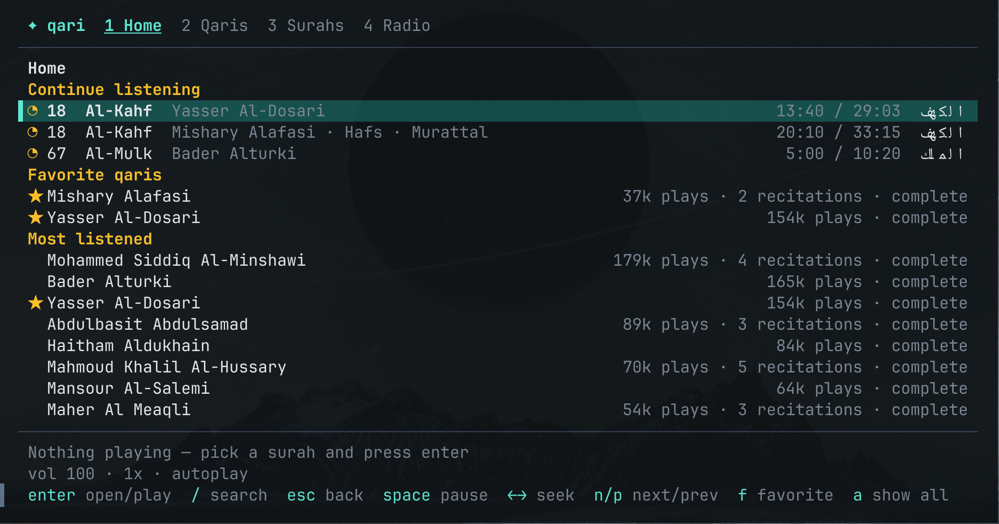
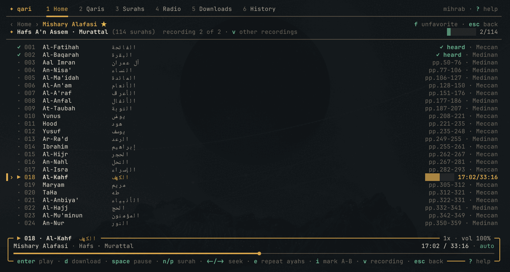
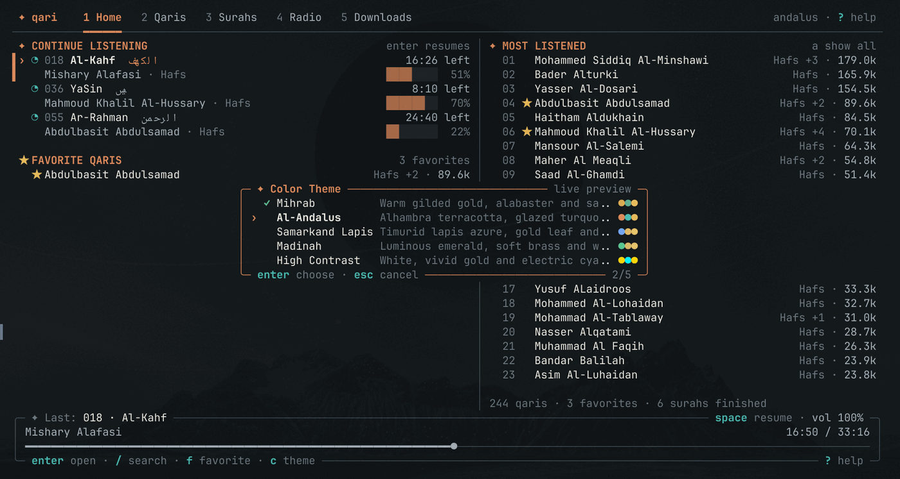

<div align="center">


<p>
<a href="https://github.com/3mro777o/qari/releases/latest"></a>
<a href="https://github.com/3mro777o/qari/actions/workflows/ci.yml"></a>
<a href="https://github.com/3mro777o/qari/actions/workflows/install.yml"></a>

<a href="LICENSE"></a>
</p>

[English](README.md) · **العربية** · [Türkçe](README.tr.md) · [Bahasa Indonesia](README.id.md) · [اردو](README.ur.md) · [Français](README.fr.md) · [Deutsch](README.de.md)

</div>

**qari** مشغّل للقرآن الكريم يعمل داخل الطرفية (terminal). يعرض أكثر من 240 قارئًا وسور القرآن الـ114
كلها من [mp3quran.net](https://mp3quran.net)، ويشغّلها عبر [mpv](https://mpv.io)، ويتذكّر أين توقفت
في كل سورة، ويكرّر الآيات لمن يريد الحفظ، ويحفظ السور على جهازك للاستماع دون اتصال. بلا حساب،
وبلا إعلانات، وبلا تتبّع.

<div align="center">

</div>

## المحتويات

- [أبرز الميزات](#أبرز-الميزات)
- [التثبيت](#التثبيت) · [التحديث](#التحديث) · [إزالة التثبيت](#إزالة-التثبيت)
- [دقائقك الخمس الأولى](#دقائقك-الخمس-الأولى)
- [أدلة الاستخدام](#أدلة-الاستخدام): [الحفظ بتكرار الآيات](#الحفظ-بتكرار-الآيات) ·
  [التشغيل العشوائي والوصفات](#التشغيل-العشوائي-والوصفات) · [الاستماع دون اتصال](#الاستماع-دون-اتصال) ·
  [الأوامر والإكمال بزر Tab](#الأوامر-والإكمال-بزر-tab) · [الراديو والسجل والمفضلة](#الراديو-والسجل-والمفضلة) ·
  [السمات](#السمات) · [أزرار الوسائط](#أزرار-الوسائط) · [النص العربي](#النص-العربي) · [الشبكات المحجوبة](#الشبكات-المحجوبة)
- [كل الأزرار](#كل-الأزرار) · [الخيارات](#الخيارات)
- [حل المشكلات](#حل-المشكلات)
- [مكان حفظ البيانات](#مكان-حفظ-البيانات) · [الخصوصية](#الخصوصية) · [بيانات الشعبية](#بيانات-الشعبية)
- [البناء من المصدر](#البناء-من-المصدر) · [شكر وتقدير](#شكر-وتقدير) · [الرخصة](#الرخصة)

## أبرز الميزات

| | |
| --- | --- |
| 🎙️ **أكثر من 240 قارئًا و114 سورة** | تصفّح حسب القارئ أو حسب السورة. يأتي أولًا القرّاء المشهورون الذين لهم تسجيل كامل، مرتّبين بأرقام استماع حقيقية. |
| 🔎 **البحث بأي كتابة** | `alafasi` و`العفاسي` و`العَفاسي` تجد القارئ نفسه، و`kahf` و`18` و`الكهف` تجد السورة نفسها. |
| 📖 **الحفظ** | كرّر مقطعًا من الآيات: كل آية N مرة، والمقطع كله M مرة، مع مهلة بين التكرارات. |
| ⏯️ **يتذكّر موضعك** | كل سورة تحتفظ بموضعها. *Continue listening* (متابعة الاستماع) تكمل من حيث توقفت، والسور المكتملة تُعلَّم بـ ✓. |
| 🎲 **التشغيل العشوائي** | وصفات مثل *Short surahs* (قصار السور) أو *Daily surahs* (سور يومية: الكهف، يس، الملك…)، أو وصفاتك الخاصة. |
| 💾 **دون اتصال** | نزّل سورة أو تسجيلًا كاملًا، فيُشغَّل بعدها من القرص بلا شبكة. |
| ⌨️ **أوامر مع Tab** | `qari play alafasi kahf` من سطر الأوامر. زر Tab يكمل أسماء القرّاء والسور والمحطات. |
| 📻 **راديو مباشر** | محطات إذاعة القرآن من mp3quran.net. |
| 🎨 **خمس سمات** | مستوحاة من الفن الإسلامي: Mihrab وAl-Andalus وSamarkand Lapis وMadinah وHigh Contrast. |
| 🖱️ **الأزرار والفأرة** | أزرار على طريقة vim وmpv تعمل أيضًا على لوحة المفاتيح العربية، مع النقر والتمرير والتقديم بالسحب. |

## التثبيت

أمر واحد يثبّت qari **و**mpv (محرك الصوت الذي يستعمله qari). انسخه في الطرفية واضغط Enter.

**Linux وmacOS**

```sh
curl -fsSL https://3mro777o.github.io/qari/install.sh | sh
```

**Windows** (افتح *PowerShell* من قائمة ابدأ؛ لا حاجة لصلاحيات المسؤول)

```powershell
irm https://3mro777o.github.io/qari/install.ps1 | iex
```

ثم اكتب `qari` واضغط Enter. إن لم يُعثر على الأمر فافتح نافذة طرفية جديدة.

<details>
<summary><b>ماذا يفعل أمر التثبيت بالضبط؟</b></summary>

من حقك أن تعرف ما يفعله الأمر قبل أن تمرّره إلى الـ shell. السكربتان قصيران، اقرأهما هنا:
[install.sh](install.sh)، [install.ps1](install.ps1).

**Linux** ([install.sh](install.sh))
1. يثبّت mpv بمدير الحزم عندك (`pacman` أو `apt` أو `dnf` أو `zypper`) إن لم يكن مثبّتًا.
   تطلب هذه الخطوة كلمة السر. وإن فشلت فإن qari يُثبَّت مع ذلك ويخبرك أن تضيف mpv بنفسك.
2. ينزّل أحدث إصدار من qari يناسب معالجك (x86-64 أو ARM64) من GitHub Releases.
3. يطابق الملف المنزَّل مع `checksums.txt` الخاص بالإصدار (SHA-256)، ويتوقف إن لم يتطابقا.
4. يضع برنامج `qari` في `/usr/local/bin` (ويطلب كلمة السر)، وهو مسار موجود في PATH على كل الأنظمة.
5. يجهّز الإكمال بزر Tab للـ shells الموجودة عندك: bash وzsh وfish.

**macOS** ([install.sh](install.sh)): يستعمل [Homebrew](https://brew.sh) (ثبّته أولًا). يضيف السكربت
هذا المستودع كـ tap، ثم يشغّل `brew install qari` الذي يثبّت أيضًا mpv والإكمال بزر Tab. وبعدها
يُبقي Homebrew الاثنين محدَّثين بـ `brew upgrade`.

**Windows** ([install.ps1](install.ps1))
1. ينزّل أحدث إصدار من qari من GitHub Releases ويتحقق من بصمة SHA-256 الخاصة به.
2. يضع `qari.exe` في `%LOCALAPPDATA%\Programs\qari` (داخل مجلد المستخدم، فلا حاجة لصلاحيات المسؤول).
3. إن لم يكن mpv مثبّتًا، ينزّل نسخة mpv المحمولة من
   [shinchiro](https://github.com/shinchiro/mpv-winbuild-cmake) إلى `%LOCALAPPDATA%\Programs\mpv`.
4. يضيف المجلدين إلى PATH الخاص بالمستخدم، فيعمل `qari` في أي طرفية جديدة.
5. يضيف سطرًا واحدًا إلى ملف تعريف PowerShell يفعّل الإكمال بزر Tab.

</details>

> [!NOTE]
> ميزة **Smart App Control في Windows** تمنع البرامج غير الموقّعة رقميًا، وqari غير موقّع بعد.
> إن رفض Windows تشغيل `qari.exe` فهذا هو السبب. انظر [حل المشكلات](#حل-المشكلات).

<details>
<summary><b>طرق أخرى للتثبيت</b> (Homebrew، Scoop، ملف تنفيذي جاهز، Go)</summary>

**Homebrew** (macOS وLinux):

```sh
brew tap 3mro777o/qari https://github.com/3mro777o/qari
brew trust 3mro777o/qari   # تطلبه إصدارات Homebrew الأحدث
brew install qari
```

**Scoop** (Windows):

```powershell
scoop bucket add qari https://github.com/3mro777o/qari
scoop bucket add extras
scoop install qari mpv
```

**ملف تنفيذي جاهز:** نزّل الأرشيف المناسب لنظامك من
[Releases](https://github.com/3mro777o/qari/releases)، وفكّ ضغطه، وضع `qari` في مكان ما ضمن
`PATH`. وثبّت **mpv** بنفسك (`sudo apt install mpv`، `brew install mpv`، …).

**عبر Go 1.24 أو أحدث** (يحتاج mpv أيضًا):

```sh
go install github.com/3mro777o/qari@latest
```

</details>

**الطرفية:** أي طرفية حديثة تكفي. على Windows استعمل *Windows Terminal* (وهي الافتراضية في
Windows 11). ولعرض الأسماء العربية انظر [النص العربي](#النص-العربي).

### التحديث

شغّل أمر التثبيت مرة أخرى. فهو يجلب أحدث إصدار دائمًا ويستبدل القديم، وتبقى مفضّلتك وتقدّمك
وتنزيلاتك كما هي. ويمكن لمستخدمي Homebrew أيضًا تشغيل `brew upgrade qari`.

يتحقق qari من GitHub مرة في اليوم، ويعرض *"qari X is out"* (صدر qari X) في أسفل الشاشة حين يتوفر إصدار جديد.

### إزالة التثبيت

بياناتك منفصلة عن البرنامج، فاحذفها أيضًا إن أردت إزالة نظيفة
(انظر [مكان حفظ البيانات](#مكان-حفظ-البيانات)).

<details>
<summary><b>Linux وmacOS وWindows</b></summary>

**Linux**

```sh
sudo rm /usr/local/bin/qari
rm -f ~/.local/share/bash-completion/completions/qari ~/.config/fish/completions/qari.fish
sudo rm -f /usr/local/share/zsh/site-functions/_qari
rm -rf ~/.local/state/qari ~/.cache/qari ~/.local/share/qari   # بياناتك، اختياري
```

إن أُضيف إكمال zsh إلى `~/.zshrc` فاحذف السطر الذي ينتهي بـ `# qari Tab completion`.

**macOS**

```sh
brew uninstall qari && brew untap 3mro777o/qari
rm -rf ~/.local/state/qari ~/Library/Caches/qari ~/.local/share/qari   # بياناتك، اختياري
```

**Windows** (PowerShell)

```powershell
Remove-Item -Recurse "$env:LOCALAPPDATA\Programs\qari"
Remove-Item -Recurse "$env:LOCALAPPDATA\Programs\mpv"            # فقط إن كان المثبِّت قد أضافه
Remove-Item -Recurse "$env:APPDATA\qari", "$env:LOCALAPPDATA\qari" # بياناتك، اختياري
```

ثم احذف المجلدين من PATH الخاص بالمستخدم (*Settings → System → About → Advanced system
settings → Environment Variables*) واحذف سطر `qari completion` من ملف التعريف (`notepad $PROFILE`).

</details>

## دقائقك الخمس الأولى

1. **افتحه.** اكتب `qari`. ستصل إلى **Home** (الرئيسية): *Continue listening*، وقرّاؤك المفضّلون،
   والقرّاء الأكثر استماعًا. التبويبات في الأعلى هي `1` Home، `2` Qaris، `3` Surahs، `4` Radio،
   `5` Downloads، `6` History، `7` Settings. اضغط رقمًا أو `tab` للتنقل بينها.

   

2. **ابحث عن قارئ.** اضغط `2`، ثم `/` واكتب جزءًا من الاسم، مثل `alafasi` أو `العفاسي`.
   تحرّك بـ `j`/`k` أو بالأسهم، وافتح بـ `enter`.
3. **شغّل سورة.** تعرض صفحة القارئ سوره. اختر واحدة واضغط `enter`. يعرض المشغّل في
   الأسفل السورة والوقت وشريط التقدّم. `space` يوقف مؤقتًا، و`←`/`→` تقدّم أو تؤخّر 10 ثوانٍ،
   و`n`/`p` للسورة التالية أو السابقة.

   

4. **اجعله على ذوقك.** `f` يضيف القارئ إلى المفضّلة، و`[`/`]` يغيّران السرعة، و`t` يضبط مؤقّت النوم،
   و`c` يغيّر الألوان.
5. **اخرج بـ `q`.** يُحفظ موضعك. وفي المرة القادمة يكمل *Continue listening* أو `space` من حيث توقفت.

تهت؟ اضغط `?` لترى كل أزرار الشاشة التي أنت فيها.

## أدلة الاستخدام

### الحفظ بتكرار الآيات

تكرار بضع آيات مرة بعد مرة هو الطريقة المعروفة للحفظ. يعرف qari بداية كل آية ونهايتها في
نحو 115 تسجيلًا، فيستطيع أن يكرّر الآيات التي تريدها بالضبط.

1. شغّل سورة (مثل سورة الكهف بصوت مشاري العفاسي).
2. اضغط `e`. تُفتح نافذة:

   | الحقل | معناه |
   | --- | --- |
   | **From ayah / To ayah** (من آية / إلى آية) | المقطع المراد تكراره. |
   | **Each ayah** (كل آية) | عدد مرات تشغيل كل آية قبل الانتقال إلى التالية (1–99). |
   | **Whole range** (المقطع كله) | عدد مرات تكرار المقطع كله (`0` = حتى توقفه أنت). |
   | **Gap** (المهلة) | ثوانٍ من الصمت قبل كل تكرار، لتردّد الآية بنفسك. |

   تنقّل بين الحقول بـ `j`/`k`، وغيّر القيمة بـ `←`/`→` أو اكتب الرقم، ثم اضغط
   `enter` للبدء.

   

3. يعرض المشغّل موضعك، مثل `ayah 3/10 · 2 of 3`. اضغط `esc` للإيقاف.

**تكرار سريع أثناء الاستماع:** اضغط `i` حين تبدأ أول آية تريدها، ثم `i` مرة أخرى
أثناء الآية الأخيرة. فيكرّر qari هذا المقطع. والضغطة الثالثة على `i` توقفه. و`u` يغيّر عدد مرات
تشغيل كل آية (1، 2، 3، 5، 7، 10).

تُحفظ إعداداتك، ويعمل التكرار على السور المنزَّلة دون شبكة. وإن لم يكن للتسجيل توقيتات
للآيات فإن qari يخبرك، ويدلّك على تسجيل آخر للقارئ نفسه فيه توقيتات (بدّل إليه بـ `v`).

### التشغيل العشوائي والوصفات

اضغط `z` لاختيار **وصفة**: وصف محفوظ لما يُشغَّل عشوائيًا. حين تنتهي سورة تبدأ
سورة عشوائية أخرى، ولا تتكرر سورة للقارئ نفسه حتى تُستنفد الوصفة. `n` يختار
غيرها، و`p` يعود إلى السابقة.

الوصفات المدمجة:

| الوصفة | ما تشغّله |
| --- | --- |
| *Anything* (أي شيء) | القرّاء المشهورون، رواية حفص، مرتّل |
| *Favorite qaris* (القرّاء المفضّلون) | مفضّلتك فقط |
| *Short surahs* (قصار السور) | جزء عمّ |
| *Daily surahs* (سور يومية) | الكهف، السجدة، يس، الواقعة، الملك |
| *Mujawwad* (مجوّد) | التلاوات المجوّدة |
| *Random radio* / *Favorite radios* (راديو عشوائي / المحطات المفضّلة) | محطات راديو مباشرة |

أنشئ وصفتك بـ `a`، أو انسخ وصفة مدمجة بـ `c` وعدّلها. تصفّي الوصفة حسب القرّاء
(الكل، المشهورون، المفضّلون، أو قائمة تختارها)، والرواية، والأسلوب (مرتّل، مجوّد، …)، والسور
(الكل، جزء عمّ، أو قائمتك). في المحرّر، `enter` يغيّر الحقل، و`/` يبحث في القوائم،
و`s` يحفظ.

### الاستماع دون اتصال

اضغط `d` على سورة لتنزيلها، أو على تسجيل لتنزيله كاملًا (اضغط `d` مرتين
للتأكيد). يعرض تبويب **Downloads** (`5`) قائمة الانتظار مع التقدّم والسرعة. السورة المنزَّلة
تُشغَّل من القرص، فتعمل في الطائرة وتوفّر بياناتك. و`x` يحذف التنزيل أو يلغيه.


### الأوامر والإكمال بزر Tab

يمكنك بدء التشغيل مباشرة من سطر الأوامر. يكفي جزء من الاسم، بالإنجليزية أو العربية، والسورة
رقم أو اسم. وإن طابق الاسم عدة قرّاء فإن qari يعرضهم لك.

```sh
qari play alafasi 18              # الكهف بصوت مشاري العفاسي، من حيث توقفت
qari play alafasi                 # يكمل آخر ما سمعته من هذا القارئ
qari radio ajmy                   # محطة راديو مباشرة
qari random "short surahs"        # تشغيل عشوائي من وصفة (بلا اسم: آخر وصفة استُعملت)
qari play alafasi yasin --no-ui   # بلا واجهة: سطر حالة واحد، وctrl+c يوقفه
qari help                         # كل الأوامر
```

تُفتح الواجهة وهي تشغّل مباشرة، وكل الأزرار متاحة. ومع `--no-ui` يشغّل qari في
خلفية الطرفية ويطبع سطر حالة واحدًا، وتتبعها السورة التالية كما في التطبيق،
ويُحفظ موضعك بالطريقة نفسها.

**الإكمال بزر Tab** يجهّزه أمر التثبيت لـ bash وzsh وfish وPowerShell. اكتب
`qari play al` واضغط Tab: ستظهر أسماء القرّاء المطابقة، وبعد الاسم يعرض Tab سور ذلك
القارئ. ويكمل أيضًا الأوامر والخيارات ومحطات الراديو والوصفات والسمات.


لتجهيزه يدويًا، حمّل مخرجات `qari completion bash|zsh|fish|powershell` في ملف بدء
الـ shell. ويتعلّم الإكمال الأسماء بعد أن تفتح qari مرة واحدة.

### الراديو والسجل والمفضلة

- **Radio** (`4`): محطات إذاعة القرآن المباشرة من mp3quran.net. `f` يضيف المحطة إلى المفضّلة.
- **History** (`6`): آخر 200 سورة ومحطة بدأتها، مجمّعة حسب اليوم، مع موضع
  توقفك. `enter` يشغّلها من جديد من ذلك الموضع، و`x` يحذف المدخل.
- **Settings** (`7`): حجم الـ buffer (كم يحفظ mpv من السورة في الذاكرة، 25 MB افتراضيًا)،
  والصوت والسرعة (يُحفظان)، ولغة الأسماء، والأسماء العربية، والإشعارات، والثيم، والرواية،
  والترتيب، والتكرار. `enter` أو `→` يغيّر السطر، و`←` يرجع خطوة. خيارات مثل `--lang` تغلبها.
- **المفضّلة:** `f` على قارئ يضيفه إلى Home وإلى وصفة *Favorite qaris*.
- **عرض الجميع:** افتراضيًا ترى القرّاء المشهورين الذين لهم تسجيل كامل. `a` يعرضهم
  جميعًا، بما فيهم التسجيلات الناقصة والقرّاء الأقل شهرة. `s` يرتّب حسب الشعبية أو الاسم أو
  آخر تحديث، و`w` يصفّي حسب الرواية (حفص، ورش، قالون، …)، و`v` يختار أحد تسجيلات القارئ.

### السمات

اضغط `c`: تعرض الشاشة كلها معاينة لكل سمة أثناء تنقّلك، و`enter` يثبّتها، و`esc` يعود.
لا تلوّن أي سمة الخلفية، فتبقى الطرفية الشفافة شفافة.

| السمة | المظهر |
| --- | --- |
| `mihrab` | **Mihrab** (المحراب، الافتراضية): ذهب مُذهَّب دافئ، ومرمر، وأخضر مريمي |
| `andalus` | **Al-Andalus** (الأندلس): طين الحمراء المحروق، وفيروزي مزجَّج، وعاجي |
| `lapis` | **Samarkand Lapis** (لازورد سمرقند): أزرق اللازورد التيموري، وورق الذهب، وحرير تحت ضوء القمر |
| `madinah` | **Madinah** (المدينة): زمرّدي مضيء، ونحاس أصفر هادئ، ولؤلؤي دافئ |
| `contrast` | **High Contrast** (تباين عالٍ): أبيض، وذهبي زاهٍ، وسماوي كهربائي |



### أزرار الوسائط

على Linux يسجّل qari نفسه كمشغّل MPRIS (`org.mpris.MediaPlayer2.qari`)، فتتحكم به أزرار الوسائط في
لوحة المفاتيح وأدوات سطح المكتب و`playerctl -p qari play-pause`، ويظهر إشعار مع كل سورة
جديدة. على macOS وWindows لا تعمل أزرار الوسائط بعد، لكن الإشعار يظهر.

### النص العربي

تظهر الأسماء بالإنجليزية افتراضيًا، ويمكنك دائمًا البحث بالعربية: `البقره` تجد Al-Baqarah.
و`--lang` يبدّل أسماء القرّاء والسور إلى أيٍّ من اللغات الـ21 التي توفرها الواجهة البرمجية (`--lang ar`،
`--lang fr`، `--lang ur`، …، و`--languages` يعرضها). و`--arabic` يضيف أسماء السور العربية بجانب
الإنجليزية.

تحتاج العربية طرفية تدعم الكتابة من اليمين إلى اليسار: Konsole وGNOME Terminal وغيرهما من طرفيات
VTE، وWezTerm، وmlterm، وWindows Terminal. وفي الطرفيات الأخرى قد تظهر الحروف العربية معكوسة
أو منفصلة.

تتبع الاختصارات مكان الزر، فتعمل على لوحة المفاتيح العربية أيضًا: `ض` يخرج مثل
`q`، و`ظ` يبحث مثل `/`.

### الشبكات المحجوبة

بعض شبكات المدارس والمكاتب تحجب mp3quran.net. إن لم تُحمَّل القوائم فاستعمل proxy مسموحًا
لك باستعماله:

```sh
qari --proxy socks5://127.0.0.1:1080
```

لا يستطيع mpv استعمال proxy من نوع SOCKS، لذا يمرّر qari الصوت إلى mpv عبر وسيط محلي صغير، فيبقى
التقديم والتأخير يعمل، وتستعمل التنزيلات الـ proxy نفسه.

## كل الأزرار

اضغط `?` داخل التطبيق لترى هذه القائمة. الأزرار على نمط mpv وcmus وvim.

| الزر | الوظيفة |
| --- | --- |
| `1`–`7`، `tab` / `shift+tab` | Home، Qaris، Surahs، Radio، Downloads، History، Settings |
| `j` `k` / `↓` `↑` | التنقّل |
| `ctrl+d` `ctrl+u` / `pgdn` `pgup` | نصف صفحة للأسفل / للأعلى |
| `g` `G` / `home` `end` | أول / آخر صف |
| `enter` / `l` | فتح أو تشغيل |
| `esc` / `h` | رجوع (يمسح البحث أولًا) |
| `/` | البحث في القائمة الحالية (بالإنجليزية أو العربية أو رقم السورة) |
| `o` | الانتقال إلى ما يُشغَّل الآن |
| `space` | تشغيل / إيقاف مؤقت (يكمل آخر سورة إن لم يكن شيء قيد التشغيل) |
| `←` `→` | تقديم أو تأخير 10 ثوانٍ |
| `,` `.` (أو `shift+←` `shift+→`) | تقديم أو تأخير دقيقة |
| `n` `p` | السورة التالية / السابقة (في التشغيل العشوائي: اختيار آخر / رجوع) |
| `z` | عشوائي: `enter` يشغّل وصفة، `a` جديدة، `e` تعديل، `c` نسخ، `x` حذف (اضغط مرتين) |
| `+` `-` | مستوى الصوت |
| `m` | كتم الصوت |
| `[` `]` | أبطأ / أسرع (0.75×–2×، وتبقى طبقة الصوت كما هي) |
| `r` | بعد انتهاء السورة: تشغيل التالية تلقائيًا، أو التكرار، أو التوقف |
| `t` | مؤقّت النوم (15–60 دقيقة أو نهاية السورة) |
| `e` | تكرار الآيات للحفظ |
| `i` | تكرار سريع: أول آية، آخر آية، إيقاف |
| `u` | عدد مرات تشغيل كل آية مكرَّرة (1–10) |
| `f` | إضافة القارئ أو المحطة إلى المفضّلة |
| `a` | القرّاء المشهورون / كل القرّاء |
| `s` | ترتيب القرّاء: الأشهر، أبجديًا A–Z، آخر تحديث |
| `w` | التصفية حسب الرواية |
| `v` | اختيار تسجيل للقارئ |
| `d` | تنزيل السورة أو التسجيل كاملًا (يطلب الضغط مرة ثانية) |
| `x` | حذف تنزيل أو إلغاؤه، أو حذف مدخل من History |
| `c` | سمة الألوان |
| `?` | المساعدة |
| `q` / `ctrl+c` | الخروج (يُحفظ موضعك) |

**الفأرة:** انقر التبويبات والصفوف، وانقر الصف مرة ثانية لفتحه أو تشغيله، ومرّر بالعجلة، وانقر
شريط التقدّم أو اسحبه للتقديم والتأخير.


## الخيارات

```text
qari [options]
qari play <qari> [surah] [--no-ui]
qari radio <station> [--no-ui]
qari random [recipe] [--no-ui]
qari completion bash|zsh|fish|powershell

--lang CODE    language for qari and surah names (default eng; see --languages)
--languages    list the languages the API offers
--theme NAME   color theme (see --themes; overrides the saved choice)
--themes       list the themes
--proxy URL    send all traffic through a proxy, e.g. socks5://127.0.0.1:1080
--arabic       also show the Arabic surah names
--no-notify    no desktop notification when a surah starts
--no-ui        with play, radio or random: play without the interface
--version      print the version
```

تضبط `QARI_LANG` و`QARI_THEME` و`QARI_PROXY` القيم الافتراضية نفسها من متغيرات البيئة.

## حل المشكلات

<details>
<summary><b>Windows: رسالة "An Application Control policy has blocked this file" / Smart App Control</b></summary>

تمنع Smart App Control كل برنامج غير موقّع رقميًا، وqari غير موقّع بعد (قُدِّم طلب للحصول على
توقيع مجاني للمشاريع مفتوحة المصدر). وحتى ذلك الحين لا سبيل إلا إيقاف
Smart App Control من *Windows Security → App & browser control → Smart App Control settings*.
وهي متوقفة أصلًا في أغلب الأجهزة، ولا تكون مفعّلة إلا في بعض تثبيتات Windows 11 الجديدة.

</details>

<details>
<summary><b>رسالة "qari: command not found" بعد التثبيت مباشرة</b></summary>

افتح طرفية جديدة: فالقديمة لا ترى PATH المحدَّث. وعلى Linux تأكد أن
`/usr/local/bin` موجود في PATH (`echo $PATH`).

</details>

<details>
<summary><b>رسالة "Install mpv to play audio" / لا يوجد صوت</b></summary>

يشغّل qari الصوت عبر mpv. ثبّته بمدير الحزم عندك (`sudo apt install mpv`،
`sudo pacman -S mpv`، `brew install mpv`)، أو شغّل أمر التثبيت مرة أخرى. وتأكد أن `mpv --version`
يعمل في طرفية جديدة.

</details>

<details>
<summary><b>القوائم لا تُحمَّل</b></summary>

غالبًا mp3quran.net محجوب على شبكتك، انظر [الشبكات المحجوبة](#الشبكات-المحجوبة). ويحتفظ qari
بآخر قوائم حمّلها لاستعمالها دون اتصال، والسور المنزَّلة تعمل دائمًا.

</details>

<details>
<summary><b>العربية تظهر معكوسة أو منفصلة الحروف</b></summary>

طرفيتك لا تدعم الكتابة من اليمين إلى اليسار. استعمل إحدى الطرفيات المذكورة في
[النص العربي](#النص-العربي)، أو شغّل البرنامج دون `--arabic` و`--lang ar`.

</details>

<details>
<summary><b>زر Tab لا يعرض شيئًا</b></summary>

افتح qari مرة واحدة ليحفظ القوائم، فالإكمال يقرأ الأسماء منها. وفي bash يجب أن تكون حزمة
`bash-completion` مثبّتة. وافتح طرفية جديدة بعد التثبيت.

</details>

<details>
<summary><b>macOS: رسالة "Refusing to load formula from untrusted tap"</b></summary>

شغّل `brew trust 3mro777o/qari` ثم ثبّت مرة أخرى. وأمر التثبيت يفعل هذا عنك.

</details>

مشكلة أخرى؟ [افتح issue](https://github.com/3mro777o/qari/issues) واذكر نظامك
وما ظهر لك.

## مكان حفظ البيانات

| ماذا | Linux / macOS | Windows |
| --- | --- | --- |
| المفضّلة والتقدّم والوصفات والسجل والإعدادات | `~/.local/state/qari/state.json` | `%AppData%\qari\state.json` |
| ذاكرة الفهرس المؤقتة | `~/.cache/qari/` (`~/Library/Caches/qari/` على macOS) | `%LocalAppData%\qari\` |
| السور المنزَّلة | `~/.local/share/qari/` | `%LocalAppData%\qari\` |

على Linux تنقل المتغيرات `XDG_STATE_HOME` و`XDG_CACHE_HOME` و`XDG_DATA_HOME` هذه المجلدات.

## الخصوصية

لا حساب في qari ولا يرسل أي إحصاءات. يتصل بمكانين فقط: mp3quran.net (القوائم،
والصوت، وتوقيتات الآيات) وGitHub (مرة في اليوم، ليعرف هل صدر إصدار أحدث). وكل ما
يتذكّره يبقى على جهازك.

## بيانات الشعبية

لا ينشر mp3quran.net أعداد الاستماع. لذا تأتي الشعبية من لقطة محفوظة في
[`internal/popular/popular.json`](internal/popular/popular.json)، يبنيها
[`tools/genpopular`](tools/genpopular/main.go) من:

- **أعداد الاستماع** المنشورة على [way2quran.com](https://www.way2quran.com/en/reciters?sortBy=-totalListens)
- **«المشهورون»**: القارئ موجود أيضًا على [quranicaudio.com](https://quranicaudio.com) أو
  [quran.com](https://quran.com)، أو يعدّه way2quran من أبرز القرّاء

تُطابَق أسماء القرّاء بين المواقع بأسمائهم العربية والإنجليزية. وحدّث اللقطة بـ
`go run ./tools/genpopular`.

## البناء من المصدر

يحتاج Go 1.24 أو أحدث، وmpv.

```sh
git clone https://github.com/3mro777o/qari && cd qari
go build -o qari . && ./qari
go test ./...
```

بنية الكود: `internal/api` (عميل mp3quran.net وذاكرته المؤقتة)، و`internal/player` (التحكم في mpv عبر JSON IPC)،
و`internal/store` (الحالة المحفوظة)، و`internal/ui` (واجهة [Bubble Tea](https://github.com/charmbracelet/bubbletea)).
تُبنى الإصدارات بـ [GoReleaser](https://goreleaser.com) عند دفع وسم `v*`.

## شكر وتقدير

التلاوات والأسماء والراديو وتوقيتات الآيات: [mp3quran.net](https://mp3quran.net). بيانات الشعبية:
way2quran.com وquranicaudio.com وquran.com. بُني باستعمال
[Bubble Tea](https://github.com/charmbracelet/bubbletea) و[mpv](https://mpv.io).

## الرخصة

[MIT](LICENSE). قد تتأخر الترجمات عن النسخة الإنجليزية، وهي المرجع عند أي اختلاف.
