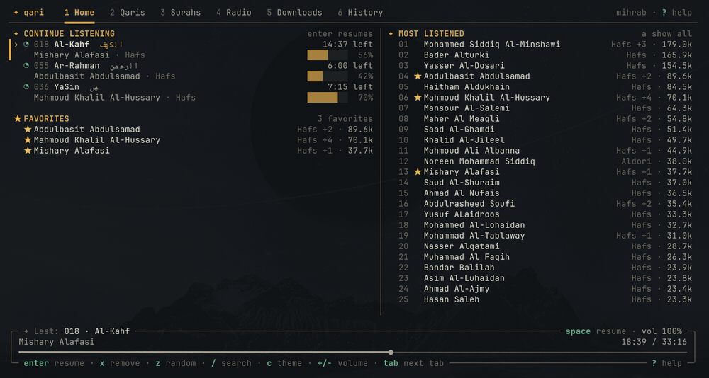
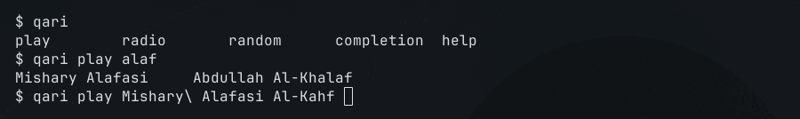

<div align="center">


<p>
<a href="https://github.com/3mro777o/qari/releases/latest"></a>
<a href="https://github.com/3mro777o/qari/actions/workflows/ci.yml"></a>
<a href="https://github.com/3mro777o/qari/actions/workflows/install.yml"></a>

<a href="LICENSE"></a>
</p>

[English](README.md) · [العربية](README.ar.md) · [Türkçe](README.tr.md) · [Bahasa Indonesia](README.id.md) · [اردو](README.ur.md) · [Français](README.fr.md) · **Deutsch**

</div>

**qari** ist ein Koran-Player für dein Terminal. Er bietet über 240 Rezitatoren (Qaris) und alle
114 Suren von [mp3quran.net](https://mp3quran.net), spielt sie über [mpv](https://mpv.io) ab,
merkt sich in jeder Sure, wo du aufgehört hast, wiederholt Verse zum Auswendiglernen und speichert
Suren zum Offline-Hören auf der Festplatte. Kein Konto, keine Werbung, kein Tracking.

<div align="center">

</div>

## Inhalt

- [Highlights](#highlights)
- [Installation](#installation) · [Aktualisieren](#aktualisieren) · [Deinstallieren](#deinstallieren)
- [Deine ersten fünf Minuten](#deine-ersten-fünf-minuten)
- [Anleitungen](#anleitungen): [Auswendiglernen mit Vers-Wiederholung](#auswendiglernen-mit-vers-wiederholung) ·
  [Zufallswiedergabe und Rezepte](#zufallswiedergabe-und-rezepte) · [Offline hören](#offline-hören) ·
  [Befehle und Tab-Vervollständigung](#befehle-und-tab-vervollständigung) · [Radio, Verlauf und Favoriten](#radio-verlauf-und-favoriten) ·
  [Farbthemen](#farbthemen) · [Medientasten](#medientasten) · [Arabischer Text](#arabischer-text) · [Gesperrte Netzwerke](#gesperrte-netzwerke)
- [Alle Tasten](#alle-tasten) · [Optionen](#optionen)
- [Fehlerbehebung](#fehlerbehebung)
- [Wo die Daten liegen](#wo-die-daten-liegen) · [Datenschutz](#datenschutz) · [Beliebtheitsdaten](#beliebtheitsdaten)
- [Aus dem Quellcode bauen](#aus-dem-quellcode-bauen) · [Danksagung](#danksagung) · [Lizenz](#lizenz)

## Highlights

| | |
| --- | --- |
| 🎙️ **Über 240 Rezitatoren, 114 Suren** | Stöbere nach Rezitator oder nach Sure. Bekannte Rezitatoren mit vollständiger Aufnahme stehen oben, sortiert nach echten Hörerzahlen. |
| 🔎 **Suche in jeder Schrift** | `alafasi`, `العفاسي` und `العَفاسي` finden denselben Rezitator; `kahf`, `18` und `الكهف` finden dieselbe Sure. |
| 📖 **Auswendiglernen (Hifz)** | Wiederhole einen Versbereich: jeden Vers N-mal, den ganzen Bereich M-mal, mit Pause dazwischen. |
| ⏯️ **Merkt sich deine Stelle** | Jede Sure behält ihre Position. *Continue listening* (Weiterhören) setzt dort fort; fertige Suren bekommen ein ✓. |
| 🎲 **Zufallswiedergabe** | Rezepte wie *Short surahs* oder *Daily surahs* (Al-Kahf, Ya-Sin, Al-Mulk…) oder deine eigenen. |
| 💾 **Offline** | Lade eine Sure oder eine ganze Aufnahme herunter; sie läuft dann ohne Netz von der Festplatte. |
| ⌨️ **Befehle mit Tab** | `qari play alafasi kahf` direkt aus der Shell. Tab vervollständigt Rezitatoren, Suren und Sender. |
| 📻 **Live-Radio** | Die Koran-Radiosender von mp3quran.net. |
| 🎨 **Fünf Farbthemen** | Inspiriert von islamischer Kunst: Mihrab, Al-Andalus, Samarkand Lapis, Madinah, High Contrast. |
| 🖱️ **Tastatur und Maus** | Tasten wie in vim/mpv, die auch mit arabischem Tastaturlayout funktionieren, dazu Klicks, Scrollen und Spulen per Ziehen. |

## Installation

Ein einziger Befehl installiert qari **und** mpv (die Audio-Engine, die qari nutzt). Kopier ihn in
ein Terminal und drück Enter.

**Linux und macOS**

```sh
curl -fsSL https://3mro777o.github.io/qari/install.sh | sh
```

**Windows** (öffne *PowerShell* über das Startmenü; keine Administratorrechte nötig)

```powershell
irm https://3mro777o.github.io/qari/install.ps1 | iex
```

Dann tipp `qari` und drück Enter. Wird der Befehl nicht gefunden, öffne ein neues Terminalfenster.

<details>
<summary><b>Was genau macht der Installationsbefehl?</b></summary>

Du solltest wissen, was ein Befehl tut, bevor du ihn in eine Shell leitest. Beide Skripte sind kurz;
lies sie hier: [install.sh](install.sh), [install.ps1](install.ps1).

**Linux** ([install.sh](install.sh))
1. Installiert mpv mit deinem Paketmanager (`pacman`, `apt`, `dnf` oder `zypper`), falls es fehlt.
   Dieser Schritt fragt nach deinem Passwort. Schlägt er fehl, wird qari trotzdem installiert und sagt dir, dass du mpv selbst installieren musst.
2. Lädt die neueste qari-Version für deinen Prozessor (x86-64 oder ARM64) von GitHub Releases herunter.
3. Prüft den Download gegen die `checksums.txt` des Releases (SHA-256) und bricht ab, wenn sie nicht passt.
4. Legt das Programm `qari` nach `/usr/local/bin` (fragt nach deinem Passwort), das überall im PATH liegt.
5. Richtet die Tab-Vervollständigung für deine Shells ein: bash, zsh und fish.

**macOS** ([install.sh](install.sh)): nutzt [Homebrew](https://brew.sh) (installier es zuerst). Das
Skript fügt dieses Repository als Tap hinzu und führt dann `brew install qari` aus, was auch mpv und
die Tab-Vervollständigung installiert. Homebrew hält danach beides mit `brew upgrade` aktuell.

**Windows** ([install.ps1](install.ps1))
1. Lädt die neueste qari-Version von GitHub Releases herunter und prüft ihre SHA-256-Prüfsumme.
2. Legt `qari.exe` nach `%LOCALAPPDATA%\Programs\qari` (dein Benutzerordner, also ohne Administratorrechte).
3. Fehlt mpv, lädt es den portablen mpv-Build von
   [shinchiro](https://github.com/shinchiro/mpv-winbuild-cmake) nach `%LOCALAPPDATA%\Programs\mpv`.
4. Fügt beide Ordner deinem Benutzer-PATH hinzu, damit `qari` in jedem neuen Terminal funktioniert.
5. Fügt deinem PowerShell-Profil eine Zeile hinzu, die die Tab-Vervollständigung einschaltet.

</details>

> [!NOTE]
> **Die intelligente App-Steuerung von Windows** (Smart App Control) blockiert Programme ohne
> Codesignatur, und qari ist noch nicht signiert. Wenn Windows `qari.exe` nicht starten will, liegt es daran. Siehe [Fehlerbehebung](#fehlerbehebung).

<details>
<summary><b>Andere Installationswege</b> (Homebrew, Scoop, Binary, Go)</summary>

**Homebrew** (macOS und Linux):

```sh
brew tap 3mro777o/qari https://github.com/3mro777o/qari
brew trust 3mro777o/qari   # neuere Homebrew-Versionen verlangen das
brew install qari
```

**Scoop** (Windows):

```powershell
scoop bucket add qari https://github.com/3mro777o/qari
scoop bucket add extras
scoop install qari mpv
```

**Fertiges Binary:** Lade das Archiv für dein System von
[Releases](https://github.com/3mro777o/qari/releases) herunter, entpack es und leg `qari` irgendwo in
deinen `PATH`. Installier **mpv** selbst (`sudo apt install mpv`, `brew install mpv`, …).

**Mit Go 1.24+** (braucht ebenfalls mpv):

```sh
go install github.com/3mro777o/qari@latest
```

</details>

**Terminal:** Jedes moderne Terminal funktioniert. Unter Windows nimm *Windows Terminal* (Standard
unter Windows 11). Für arabische Namen siehe [Arabischer Text](#arabischer-text).

### Aktualisieren

Führ den Installationsbefehl einfach noch einmal aus. Er holt immer die neueste Version und ersetzt
die alte; deine Favoriten, dein Fortschritt und deine Downloads bleiben erhalten. Mit Homebrew geht
auch `brew upgrade qari`.

qari schaut einmal am Tag auf GitHub nach und zeigt *"qari X is out"* in der Fußzeile, wenn eine neue
Version bereitsteht.

### Deinstallieren

Deine Daten liegen getrennt vom Programm; lösch sie mit, wenn du alles restlos entfernen willst
(siehe [Wo die Daten liegen](#wo-die-daten-liegen)).

<details>
<summary><b>Linux, macOS, Windows</b></summary>

**Linux**

```sh
sudo rm /usr/local/bin/qari
rm -f ~/.local/share/bash-completion/completions/qari ~/.config/fish/completions/qari.fish
sudo rm -f /usr/local/share/zsh/site-functions/_qari
rm -rf ~/.local/state/qari ~/.cache/qari ~/.local/share/qari   # deine Daten, optional
```

Falls die zsh-Vervollständigung in `~/.zshrc` eingetragen wurde, lösch die Zeile, die mit `# qari Tab completion` endet.

**macOS**

```sh
brew uninstall qari && brew untap 3mro777o/qari
rm -rf ~/.local/state/qari ~/Library/Caches/qari ~/.local/share/qari   # deine Daten, optional
```

**Windows** (PowerShell)

```powershell
Remove-Item -Recurse "$env:LOCALAPPDATA\Programs\qari"
Remove-Item -Recurse "$env:LOCALAPPDATA\Programs\mpv"            # nur, wenn der Installer es hinzugefügt hat
Remove-Item -Recurse "$env:APPDATA\qari", "$env:LOCALAPPDATA\qari" # deine Daten, optional
```

Entfern danach die beiden Ordner aus deinem Benutzer-PATH (*Einstellungen → System → Info → Erweiterte
Systemeinstellungen → Umgebungsvariablen*) und die Zeile `qari completion` aus deinem Profil (`notepad $PROFILE`).

</details>

## Deine ersten fünf Minuten

1. **Starte es.** Tipp `qari`. Du landest auf **Home** (Startseite): *Continue listening*, deine
   Lieblingsrezitatoren und die meistgehörten Rezitatoren. Die Tabs oben sind `1` Home, `2` Qaris,
   `3` Surahs, `4` Radio, `5` Downloads, `6` History. Drück eine Zahl oder `tab`, um zu wechseln.

   

2. **Finde einen Rezitator.** Drück `2`, dann `/`, und tipp einen Teil des Namens, z. B. `alafasi`
   oder `العفاسي`. Beweg dich mit `j`/`k` oder den Pfeiltasten, öffne mit `enter`.
3. **Spiel eine Sure ab.** Die Seite des Rezitators listet seine Suren. Wähl eine aus und drück
   `enter`. Der Player unten zeigt die Sure, die Zeit und einen Fortschrittsbalken. `space` pausiert,
   `←`/`→` spulen 10 Sekunden, `n`/`p` springen zur nächsten oder vorherigen Sure.

   

4. **Mach es zu deinem.** `f` markiert einen Rezitator als Favoriten, `[`/`]` ändern das Tempo, `t`
   stellt einen Sleep-Timer, `c` ändert die Farben.
5. **Beende mit `q`.** Deine Stelle wird gespeichert. Beim nächsten Mal setzt *Continue listening* oder `space` dort fort.

Verloren? Drück `?` für alle Tasten des Bildschirms, auf dem du gerade bist.

## Anleitungen

### Auswendiglernen mit Vers-Wiederholung

Ein paar Verse immer wieder zu hören ist der klassische Weg zum Auswendiglernen (Hifz). qari weiß bei
etwa 115 Aufnahmen, wo jeder Vers beginnt und endet, und kann so genau die Verse wiederholen, die du willst.

1. Spiel eine Sure ab (zum Beispiel Al-Kahf von Mishary Alafasi).
2. Drück `e`. Ein Fenster öffnet sich:

   | Feld | Bedeutung |
   | --- | --- |
   | **From ayah / To ayah** | Der Versbereich, der wiederholt wird (von Vers … bis Vers …). |
   | **Each ayah** | Wie oft jeder Vers läuft, bevor es weitergeht (1–99). |
   | **Whole range** | Wie oft der ganze Bereich läuft (`0` = bis du stoppst). |
   | **Gap** | Sekunden Stille vor jeder Wiederholung, Zeit, um den Vers selbst nachzusprechen. |

   Wechsle zwischen den Feldern mit `j`/`k`, ändere einen Wert mit `←`/`→` oder tipp die Zahl ein, und
   drück dann `enter`, um zu starten.

   

3. Der Player zeigt, wo du bist, z. B. `ayah 3/10 · 2 of 3`. Mit `esc` stoppst du.

**Schnelle Wiederholung beim Zuhören:** Drück `i`, wenn der erste gewünschte Vers beginnt, und noch
einmal `i` während des letzten. qari wiederholt diesen Bereich in Schleife. Ein drittes `i` stoppt.
`u` ändert, wie oft jeder Vers läuft (1, 2, 3, 5, 7, 10).

Deine Einstellungen werden gespeichert, und die Wiederholung funktioniert auch mit heruntergeladenen
Suren ohne Netz. Hat eine Aufnahme keine Verszeiten, sagt qari dir das und verweist auf eine andere
Aufnahme desselben Rezitators, die sie hat (wechseln mit `v`).

### Zufallswiedergabe und Rezepte

Drück `z`, um ein **Rezept** zu wählen: eine gespeicherte Beschreibung dessen, was zufällig gespielt
werden soll. Endet eine Sure, startet eine andere zufällige; keine Sure desselben Rezitators kommt
doppelt, bis das Rezept aufgebraucht ist. `n` wählt eine andere, `p` geht zurück.

Eingebaute Rezepte:

| Rezept | Spielt |
| --- | --- |
| *Anything* | Bekannte Rezitatoren, Hafs, Murattal |
| *Favorite qaris* | Nur deine Favoriten |
| *Short surahs* | Juz Amma |
| *Daily surahs* | Al-Kahf, As-Sajdah, Ya-Sin, Al-Waqi'ah, Al-Mulk |
| *Mujawwad* | Mujawwad-Rezitationen |
| *Random radio* / *Favorite radios* | Live-Radiosender |

Erstell dein eigenes mit `a` oder kopier ein eingebautes mit `c` und pass es an. Ein Rezept filtert
nach Rezitatoren (alle, bekannte, Favoriten oder eine eigene Liste), Riwaya, Stil (Murattal,
Mujawwad, …) und Suren (alle, Juz Amma oder deine Liste). Im Editor ändert `enter` ein Feld, `/`
durchsucht die Listen und `s` speichert.

### Offline hören

Drück `d` auf einer Sure, um sie herunterzuladen, oder auf einer Aufnahme, um sie komplett
herunterzuladen (zum Bestätigen `d` zweimal drücken). Der Tab **Downloads** (`5`) zeigt die
Warteschlange mit Fortschritt und Geschwindigkeit. Eine heruntergeladene Sure läuft von der
Festplatte, funktioniert also auch im Flugzeug und spart Datenvolumen. `x` löscht einen Download oder bricht ihn ab.


### Befehle und Tab-Vervollständigung

Du kannst direkt aus der Shell losspielen. Namen dürfen unvollständig sein, auf Englisch oder
Arabisch; eine Sure ist eine Nummer oder ein Name. Passt ein Name auf mehrere Rezitatoren, listet
qari sie auf.

```sh
qari play alafasi 18              # Al-Kahf von Mishary Alafasi, ab der Stelle, an der du aufgehört hast
qari play alafasi                 # setzt fort, was du zuletzt von diesem Rezitator gehört hast
qari radio ajmy                   # ein Live-Radiosender
qari random "short surahs"        # Zufallswiedergabe aus einem Rezept (ohne Namen: das zuletzt genutzte)
qari play alafasi yasin --no-ui   # ohne Oberfläche: eine Statuszeile, ctrl+c stoppt
qari help                         # alle Befehle
```

Die Oberfläche öffnet sich bereits beim Abspielen, mit allen Tasten. Mit `--no-ui` spielt qari im
Hintergrund deines Terminals und gibt eine einzige Statuszeile aus; die nächste Sure folgt wie in der
App, und deine Stelle wird genauso gespeichert.

**Die Tab-Vervollständigung** richtet der Installationsbefehl für bash, zsh, fish und PowerShell ein.
Tipp `qari play al` und drück Tab: Du bekommst passende Rezitatoren; nach einem Namen bietet Tab die
Suren dieses Rezitators an. Sie vervollständigt auch Befehle, Optionen, Radiosender, Rezepte und Farbthemen.



Um sie von Hand einzurichten, lade die Ausgabe von `qari completion bash|zsh|fish|powershell` in der
Startdatei deiner Shell. Die Vervollständigung kennt die Namen, sobald du qari einmal geöffnet hast.

### Radio, Verlauf und Favoriten

- **Radio** (`4`): Live-Koran-Radiosender von mp3quran.net. `f` markiert einen Sender als Favoriten.
- **History** (`6`, Verlauf): die letzten 200 Suren und Sender, die du gestartet hast, nach Tagen
  gruppiert, mit der Stelle, an der du aufgehört hast. `enter` spielt einen Eintrag ab dieser Stelle
  erneut; `x` entfernt einen Eintrag.
- **Favoriten:** `f` auf einem Rezitator fügt ihn zu Home und zum Rezept *Favorite qaris* hinzu.
- **Alle anzeigen:** Standardmäßig siehst du bekannte Rezitatoren mit vollständiger Aufnahme. `a`
  zeigt alle, auch unvollständige und weniger bekannte Aufnahmen. `s` sortiert nach Beliebtheit, Name
  oder letzter Aktualisierung, `w` filtert nach Riwaya (Hafs, Warsh, Qalun, …), `v` wählt eine der
  Aufnahmen eines Rezitators.

### Farbthemen

Drück `c`: Der ganze Bildschirm zeigt beim Durchblättern eine Vorschau jedes Themas, `enter` übernimmt
es, `esc` geht zurück. Kein Thema malt einen Hintergrund, ein transparentes Terminal bleibt also transparent.

| Thema | Aussehen |
| --- | --- |
| `mihrab` | **Mihrab** (Standard): warmes vergoldetes Gold, Alabaster und Salbeigrün |
| `andalus` | **Al-Andalus**: Terrakotta der Alhambra, glasiertes Türkis und Elfenbein |
| `lapis` | **Samarkand Lapis**: timuridisches Lapislazuli-Blau, Blattgold und Seide im Mondlicht |
| `madinah` | **Madinah**: leuchtendes Smaragdgrün, sanftes Messing und warmes Perlweiß |
| `contrast` | **High Contrast**: Weiß, kräftiges Gold und elektrisches Cyan |


### Medientasten

Unter Linux meldet sich qari als MPRIS-Player an (`org.mpris.MediaPlayer2.qari`), sodass
Medientasten der Tastatur, Desktop-Widgets und `playerctl -p qari play-pause` ihn steuern, und eine
Benachrichtigung zeigt jede neue Sure an. Unter macOS und Windows gibt es noch keine Medientasten;
die Benachrichtigung bekommst du trotzdem.

### Arabischer Text

Namen erscheinen standardmäßig auf Englisch, und du kannst immer auf Arabisch suchen: `البقره` findet
Al-Baqarah. `--lang` stellt die Namen von Rezitatoren und Suren auf eine der 21 Sprachen um, die die
API anbietet (`--lang ar`, `--lang fr`, `--lang ur`, …; `--languages` listet sie). `--arabic` zeigt
die arabischen Surennamen neben den englischen.

Arabisch braucht ein Terminal, das Text von rechts nach links unterstützt: Konsole, GNOME Terminal
und andere VTE-Terminals, WezTerm, mlterm, Windows Terminal. In anderen Terminals können arabische
Buchstaben umgedreht oder unverbunden erscheinen.

Tastenkürzel richten sich nach der Position der Taste, funktionieren also auch mit arabischem
Tastaturlayout: `ض` beendet wie `q`, `ظ` sucht wie `/`.

### Gesperrte Netzwerke

Manche Schul- und Firmennetzwerke sperren mp3quran.net. Wenn die Listen nicht laden, nutz einen
Proxy, den du verwenden darfst:

```sh
qari --proxy socks5://127.0.0.1:1080
```

mpv kann keine SOCKS-Proxys nutzen, deshalb leitet qari den Ton über ein kleines lokales Relay an mpv
weiter; Spulen funktioniert trotzdem, und Downloads laufen über denselben Proxy.

## Alle Tasten

Drück `?` in der App, um diese Liste zu sehen. Die Tasten orientieren sich an mpv, cmus und vim.

| Taste | Aktion |
| --- | --- |
| `1`–`6`, `tab` / `shift+tab` | Home, Qaris, Surahs, Radio, Downloads, History |
| `j` `k` / `↓` `↑` | Bewegen |
| `ctrl+d` `ctrl+u` / `pgdn` `pgup` | Halbe Seite runter / hoch |
| `g` `G` / `home` `end` | Erste / letzte Zeile |
| `enter` / `l` | Öffnen oder abspielen |
| `esc` / `h` | Zurück (leert zuerst die Suche) |
| `/` | Aktuelle Liste durchsuchen (Englisch, Arabisch oder Surennummer) |
| `o` | Zum gerade Gespielten springen |
| `space` | Abspielen / Pause (setzt im Leerlauf deine letzte Sure fort) |
| `←` `→` | 10 Sekunden spulen |
| `,` `.` (oder `shift+←` `shift+→`) | 1 Minute spulen |
| `n` `p` | Nächste / vorherige Sure (bei Zufallswiedergabe: neue Auswahl / zurück) |
| `z` | Zufall: `enter` spielt ein Rezept; `a` neu, `e` bearbeiten, `c` kopieren, `x` löschen (zweimal drücken) |
| `+` `-` | Lautstärke |
| `m` | Stumm |
| `[` `]` | Langsamer / schneller (0,75×–2×, Tonhöhe bleibt gleich) |
| `r` | Nach einer Sure: nächste automatisch abspielen, wiederholen oder stoppen |
| `t` | Sleep-Timer (15–60 Min. oder Ende der Sure) |
| `e` | Verse zum Auswendiglernen wiederholen |
| `i` | Schnelle Wiederholung: erster Vers, letzter Vers, stoppen |
| `u` | Wie oft jeder wiederholte Vers läuft (1–10) |
| `f` | Rezitator oder Sender als Favorit |
| `a` | Bekannte Rezitatoren / alle Rezitatoren |
| `s` | Rezitatoren sortieren: beliebt, A–Z, kürzlich aktualisiert |
| `w` | Nach Riwaya filtern |
| `v` | Aufnahme eines Rezitators wählen |
| `d` | Sure oder ganze Aufnahme herunterladen (fragt nach erneutem Drücken) |
| `x` | Download löschen oder abbrechen; Eintrag aus dem Verlauf entfernen |
| `c` | Farbthema |
| `?` | Hilfe |
| `q` / `ctrl+c` | Beenden (deine Stelle wird gespeichert) |

**Maus:** Klick auf Tabs und Zeilen, klick eine Zeile erneut, um sie zu öffnen oder abzuspielen,
scroll mit dem Mausrad, klick oder zieh am Fortschrittsbalken, um zu spulen.


## Optionen

```text
qari [options]
qari play <qari> [surah] [--no-ui]
qari radio <station> [--no-ui]
qari random [recipe] [--no-ui]
qari completion bash|zsh|fish|powershell

--lang CODE    language for qari and surah names (default eng; see --languages)
--languages    list the languages the API offers
--theme NAME   color theme (see --themes; overrides the saved choice)
--themes       list the themes
--proxy URL    send all traffic through a proxy, e.g. socks5://127.0.0.1:1080
--arabic       also show the Arabic surah names
--no-notify    no desktop notification when a surah starts
--no-ui        with play, radio or random: play without the interface
--version      print the version
```

`QARI_LANG`, `QARI_THEME` und `QARI_PROXY` setzen dieselben Standardwerte über Umgebungsvariablen.

## Fehlerbehebung

<details>
<summary><b>Windows: "An Application Control policy has blocked this file" / intelligente App-Steuerung</b></summary>

Die intelligente App-Steuerung (Smart App Control) blockiert jedes Programm ohne Codesignatur, und
qari ist noch nicht signiert (kostenlose Codesignatur für Open-Source-Projekte ist beantragt). Bis
dahin hilft nur, sie auszuschalten: *Windows-Sicherheit → App- & Browsersteuerung → Einstellungen für
intelligente App-Steuerung*. Auf den meisten PCs ist sie ohnehin aus; aktiv ist sie nur bei manchen
Neuinstallationen von Windows 11.

</details>

<details>
<summary><b>"qari: command not found" direkt nach der Installation</b></summary>

Öffne ein neues Terminal: Das alte sieht den aktualisierten PATH nicht. Unter Linux prüf, ob
`/usr/local/bin` in deinem PATH ist (`echo $PATH`).

</details>

<details>
<summary><b>"Install mpv to play audio" / kein Ton</b></summary>

qari spielt über mpv ab. Installier es mit deinem Paketmanager (`sudo apt install mpv`,
`sudo pacman -S mpv`, `brew install mpv`) oder führ den Installationsbefehl erneut aus. Prüf, ob
`mpv --version` in einem neuen Terminal funktioniert.

</details>

<details>
<summary><b>Die Listen laden nicht</b></summary>

mp3quran.net ist in deinem Netzwerk wahrscheinlich gesperrt; siehe [Gesperrte Netzwerke](#gesperrte-netzwerke).
qari behält die zuletzt geladenen Listen für die Offline-Nutzung, und heruntergeladene Suren laufen immer.

</details>

<details>
<summary><b>Arabisch erscheint umgedreht oder unverbunden</b></summary>

Dein Terminal unterstützt keinen Text von rechts nach links. Nimm eines der Terminals aus
[Arabischer Text](#arabischer-text) oder starte qari ohne `--arabic` und `--lang ar`.

</details>

<details>
<summary><b>Tab zeigt nichts an</b></summary>

Öffne qari einmal, damit es die Listen speichert; die Vervollständigung liest die Namen daraus. Für
bash muss das Paket `bash-completion` installiert sein. Starte nach der Installation ein neues Terminal.

</details>

<details>
<summary><b>macOS: "Refusing to load formula from untrusted tap"</b></summary>

Führ `brew trust 3mro777o/qari` aus und installier dann erneut. Der Installationsbefehl erledigt das für dich.

</details>

Etwas anderes? [Eröffne ein Issue](https://github.com/3mro777o/qari/issues) mit deinem System und dem,
was du gesehen hast.

## Wo die Daten liegen

| Was | Linux / macOS | Windows |
| --- | --- | --- |
| Favoriten, Fortschritt, Rezepte, Verlauf, Einstellungen | `~/.local/state/qari/state.json` | `%AppData%\qari\state.json` |
| Katalog-Cache | `~/.cache/qari/` (`~/Library/Caches/qari/` unter macOS) | `%LocalAppData%\qari\` |
| Heruntergeladene Suren | `~/.local/share/qari/` | `%LocalAppData%\qari\` |

Unter Linux verschieben die Variablen `XDG_STATE_HOME`, `XDG_CACHE_HOME` und `XDG_DATA_HOME` diese Ordner.

## Datenschutz

qari hat kein Konto und sendet keine Analysedaten. Es spricht nur mit zwei Stellen: mp3quran.net (die
Listen, der Ton und die Verszeiten) und GitHub (einmal am Tag, um nach einer neueren Version zu
sehen). Alles, was es sich merkt, bleibt auf deinem Computer.

## Beliebtheitsdaten

mp3quran.net veröffentlicht keine Abrufzahlen. Die Beliebtheit stammt aus einem Schnappschuss in
[`internal/popular/popular.json`](internal/popular/popular.json), erstellt von
[`tools/genpopular`](tools/genpopular/main.go) aus:

- **Hörerzahlen**, veröffentlicht von [way2quran.com](https://www.way2quran.com/en/reciters?sortBy=-totalListens)
- **„bekannt“**: Der Rezitator ist auch auf [quranicaudio.com](https://quranicaudio.com) oder
  [quran.com](https://quran.com) vertreten, oder way2quran führt ihn als Top-Rezitator

Rezitatoren werden über ihre arabischen und englischen Namen seitenübergreifend zugeordnet. Den
Schnappschuss aktualisierst du mit `go run ./tools/genpopular`.

## Aus dem Quellcode bauen

Braucht Go 1.24+ und mpv.

```sh
git clone https://github.com/3mro777o/qari && cd qari
go build -o qari . && ./qari
go test ./...
```

Der Code: `internal/api` (mp3quran.net-Client und Cache), `internal/player` (mpv über JSON IPC),
`internal/store` (gespeicherter Zustand), `internal/ui` (die [Bubble Tea](https://github.com/charmbracelet/bubbletea)-Oberfläche).
Releases baut [GoReleaser](https://goreleaser.com), sobald ein `v*`-Tag gepusht wird.

## Danksagung

Rezitationen, Namen, Radio und Verszeiten: [mp3quran.net](https://mp3quran.net). Beliebtheitsdaten:
way2quran.com, quranicaudio.com und quran.com. Gebaut mit
[Bubble Tea](https://github.com/charmbracelet/bubbletea) und [mpv](https://mpv.io).

## Lizenz

[MIT](LICENSE). Übersetzungen können der englischen Fassung hinterherhinken; bei Abweichungen gilt
die [englische README](README.md).
