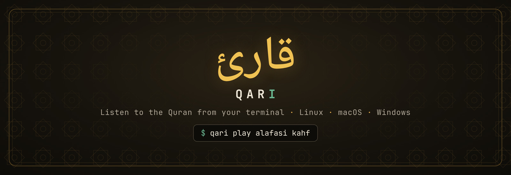
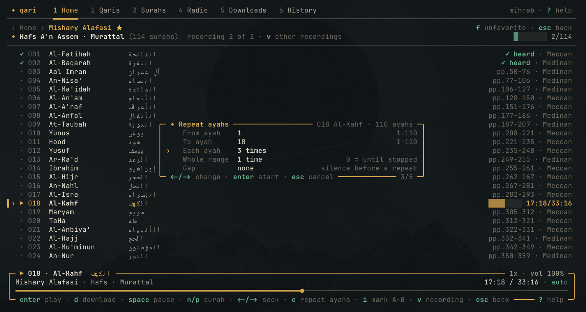
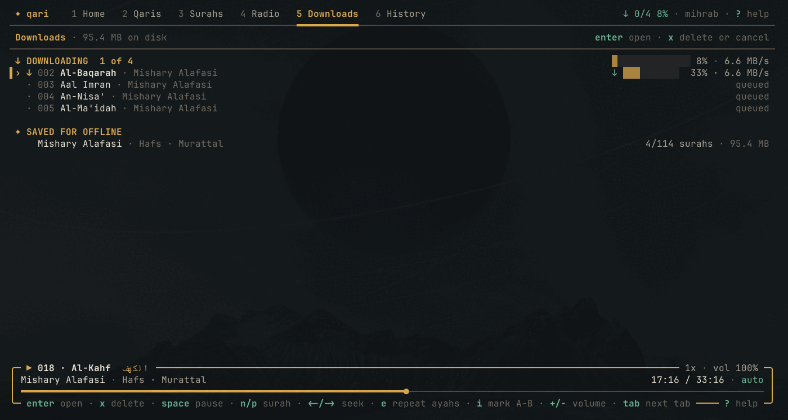

<div align="center">



<p>
<a href="https://github.com/3mro777o/qari/releases/latest"></a>
<a href="https://github.com/3mro777o/qari/actions/workflows/ci.yml"></a>
<a href="https://github.com/3mro777o/qari/actions/workflows/install.yml"></a>

<a href="LICENSE"></a>
</p>

[English](README.md) · [العربية](README.ar.md) · [Türkçe](README.tr.md) · [Bahasa Indonesia](README.id.md) · [اردو](README.ur.md) · **Français** · [Deutsch](README.de.md)

</div>

**qari** est un lecteur de Coran qui vit dans votre terminal. Il propose plus de 240 récitateurs
(qaris) et les 114 sourates de [mp3quran.net](https://mp3quran.net), les lit avec [mpv](https://mpv.io),
retient où vous vous êtes arrêté dans chaque sourate, répète des versets pour la mémorisation et
garde des sourates sur le disque pour les écouter hors ligne. Pas de compte, pas de publicité, pas de pistage.

<div align="center">

</div>

## Sommaire

- [Points forts](#points-forts)
- [Installation](#installation) · [Mise à jour](#mise-à-jour) · [Désinstallation](#désinstallation)
- [Vos cinq premières minutes](#vos-cinq-premières-minutes)
- [Guides](#guides) : [Mémoriser en répétant des versets](#mémoriser-en-répétant-des-versets) ·
  [Lecture aléatoire et recettes](#lecture-aléatoire-et-recettes) · [Écoute hors ligne](#écoute-hors-ligne) ·
  [Commandes et complétion avec Tab](#commandes-et-complétion-avec-tab) · [Radio, historique et favoris](#radio-historique-et-favoris) ·
  [Thèmes](#thèmes) · [Touches multimédia](#touches-multimédia) · [Texte arabe](#texte-arabe) · [Réseaux bloqués](#réseaux-bloqués)
- [Toutes les touches](#toutes-les-touches) · [Options](#options)
- [Dépannage](#dépannage)
- [Où sont stockées les données](#où-sont-stockées-les-données) · [Confidentialité](#confidentialité) · [Données de popularité](#données-de-popularité)
- [Compiler depuis les sources](#compiler-depuis-les-sources) · [Remerciements](#remerciements) · [Licence](#licence)

## Points forts

| | |
| --- | --- |
| 🎙️ **Plus de 240 récitateurs, 114 sourates** | Parcourez par récitateur ou par sourate. Les récitateurs connus avec un enregistrement complet viennent en premier, classés selon le nombre réel d'écoutes. |
| 🔎 **Recherche dans toutes les écritures** | `alafasi`, `العفاسي` et `العَفاسي` trouvent le même récitateur ; `kahf`, `18` et `الكهف` trouvent la même sourate. |
| 📖 **Mémorisation (hifz)** | Répétez une série de versets : chaque verset N fois, toute la série M fois, avec une pause entre les deux. |
| ⏯️ **Retient où vous en êtes** | Chaque sourate garde sa position. *Continue listening* (reprendre l'écoute) la reprend ; les sourates terminées reçoivent un ✓. |
| 🎲 **Lecture aléatoire** | Des recettes comme *Short surahs* ou *Daily surahs* (Al-Kahf, Ya-Sin, Al-Mulk…), ou les vôtres. |
| 💾 **Hors ligne** | Téléchargez une sourate ou un enregistrement entier ; il se lit ensuite depuis le disque, sans réseau. |
| ⌨️ **Commandes avec Tab** | `qari play alafasi kahf` depuis le shell. Tab complète les noms de récitateurs, les sourates et les stations. |
| 📻 **Radio en direct** | Les stations de radio coraniques de mp3quran.net. |
| 🎨 **Cinq thèmes** | Inspirés de l'art islamique : Mihrab, Al-Andalus, Samarkand Lapis, Madinah, High Contrast. |
| 🖱️ **Clavier et souris** | Des touches à la vim/mpv qui marchent aussi avec la disposition arabe, plus les clics, la molette et l'avance par glisser. |

## Installation

Une seule commande installe qari **et** mpv (le moteur audio qu'utilise qari). Copiez-la dans un
terminal et appuyez sur Entrée.

**Linux et macOS**

```sh
curl -fsSL https://3mro777o.github.io/qari/install.sh | sh
```

**Windows** (ouvrez *PowerShell* depuis le menu Démarrer ; pas besoin de droits administrateur)

```powershell
irm https://3mro777o.github.io/qari/install.ps1 | iex
```

Tapez ensuite `qari` et appuyez sur Entrée. Si la commande est introuvable, ouvrez une nouvelle fenêtre de terminal.

<details>
<summary><b>Que fait exactement la commande d'installation ?</b></summary>

Mieux vaut savoir ce que fait une commande avant de l'envoyer dans un shell. Les deux scripts sont
courts ; lisez-les ici : [install.sh](install.sh), [install.ps1](install.ps1).

**Linux** ([install.sh](install.sh))
1. Installe mpv avec votre gestionnaire de paquets (`pacman`, `apt`, `dnf` ou `zypper`) s'il manque.
   Cette étape demande votre mot de passe. Si elle échoue, qari s'installe quand même et vous indique d'ajouter mpv vous-même.
2. Télécharge la dernière version de qari pour votre processeur (x86-64 ou ARM64) depuis GitHub Releases.
3. Vérifie le téléchargement avec le fichier `checksums.txt` de la version (SHA-256) et s'arrête s'il ne correspond pas.
4. Place le programme `qari` dans `/usr/local/bin` (demande votre mot de passe), qui est dans le PATH partout.
5. Configure la complétion avec Tab pour les shells présents : bash, zsh et fish.

**macOS** ([install.sh](install.sh)) : utilise [Homebrew](https://brew.sh) (installez-le d'abord). Le
script ajoute ce dépôt comme tap, puis lance `brew install qari`, qui installe aussi mpv et la
complétion avec Tab. Homebrew garde ensuite les deux à jour avec `brew upgrade`.

**Windows** ([install.ps1](install.ps1))
1. Télécharge la dernière version de qari depuis GitHub Releases et vérifie sa somme de contrôle SHA-256.
2. Place `qari.exe` dans `%LOCALAPPDATA%\Programs\qari` (votre dossier utilisateur, donc sans droits administrateur).
3. Si mpv manque, télécharge la version portable de mpv de
   [shinchiro](https://github.com/shinchiro/mpv-winbuild-cmake) dans `%LOCALAPPDATA%\Programs\mpv`.
4. Ajoute les deux dossiers à votre PATH utilisateur, pour que `qari` marche dans tout nouveau terminal.
5. Ajoute une ligne à votre profil PowerShell pour activer la complétion avec Tab.

</details>

> [!NOTE]
> **Le Contrôle intelligent des applications de Windows** (Smart App Control) bloque les programmes
> non signés, et qari n'est pas encore signé. Si Windows refuse de lancer `qari.exe`, c'est pour cette raison. Voir [Dépannage](#dépannage).

<details>
<summary><b>Autres méthodes d'installation</b> (Homebrew, Scoop, binaire, Go)</summary>

**Homebrew** (macOS et Linux) :

```sh
brew tap 3mro777o/qari https://github.com/3mro777o/qari
brew trust 3mro777o/qari   # demandé par les versions récentes de Homebrew
brew install qari
```

**Scoop** (Windows) :

```powershell
scoop bucket add qari https://github.com/3mro777o/qari
scoop bucket add extras
scoop install qari mpv
```

**Binaire précompilé :** téléchargez l'archive pour votre système depuis
[Releases](https://github.com/3mro777o/qari/releases), extrayez-la et placez `qari` quelque part dans
votre `PATH`. Installez **mpv** vous-même (`sudo apt install mpv`, `brew install mpv`, …).

**Avec Go 1.24+** (mpv est aussi nécessaire) :

```sh
go install github.com/3mro777o/qari@latest
```

</details>

**Terminal :** n'importe quel terminal moderne convient. Sous Windows, utilisez *Windows Terminal*
(celui par défaut sous Windows 11). Pour les noms en arabe, voir [Texte arabe](#texte-arabe).

### Mise à jour

Relancez la commande d'installation. Elle récupère toujours la version la plus récente et remplace
l'ancienne ; vos favoris, votre progression et vos téléchargements sont conservés. Avec Homebrew, vous
pouvez aussi lancer `brew upgrade qari`.

qari consulte GitHub une fois par jour et affiche *"qari X is out"* dans son pied de page quand une
nouvelle version est disponible.

### Désinstallation

Vos données sont séparées du programme ; supprimez-les aussi si vous voulez tout effacer
(voir [Où sont stockées les données](#où-sont-stockées-les-données)).

<details>
<summary><b>Linux, macOS, Windows</b></summary>

**Linux**

```sh
sudo rm /usr/local/bin/qari
rm -f ~/.local/share/bash-completion/completions/qari ~/.config/fish/completions/qari.fish
sudo rm -f /usr/local/share/zsh/site-functions/_qari
rm -rf ~/.local/state/qari ~/.cache/qari ~/.local/share/qari   # vos données, facultatif
```

Si la complétion zsh a été ajoutée à `~/.zshrc`, supprimez la ligne qui se termine par `# qari Tab completion`.

**macOS**

```sh
brew uninstall qari && brew untap 3mro777o/qari
rm -rf ~/.local/state/qari ~/Library/Caches/qari ~/.local/share/qari   # vos données, facultatif
```

**Windows** (PowerShell)

```powershell
Remove-Item -Recurse "$env:LOCALAPPDATA\Programs\qari"
Remove-Item -Recurse "$env:LOCALAPPDATA\Programs\mpv"            # seulement si l'installateur l'a ajouté
Remove-Item -Recurse "$env:APPDATA\qari", "$env:LOCALAPPDATA\qari" # vos données, facultatif
```

Retirez ensuite les deux dossiers de votre PATH utilisateur (*Paramètres → Système → Informations
système → Paramètres avancés du système → Variables d'environnement*) et la ligne `qari completion`
de votre profil (`notepad $PROFILE`).

</details>

## Vos cinq premières minutes

1. **Lancez-le.** Tapez `qari`. Vous arrivez sur **Home** (accueil) : *Continue listening*, vos
   récitateurs favoris et les récitateurs les plus écoutés. Les onglets en haut sont `1` Home,
   `2` Qaris, `3` Surahs, `4` Radio, `5` Downloads, `6` History. Appuyez sur un chiffre ou sur `tab` pour changer.

   

2. **Trouvez un récitateur.** Appuyez sur `2`, puis sur `/` et tapez une partie d'un nom, par exemple
   `alafasi` ou `العفاسي`. Déplacez-vous avec `j`/`k` ou les flèches, ouvrez avec `enter`.
3. **Écoutez une sourate.** La page du récitateur liste ses sourates. Choisissez-en une et appuyez sur
   `enter`. Le lecteur en bas affiche la sourate, le temps et une barre de progression. `space` met en
   pause, `←`/`→` avancent ou reculent de 10 secondes, `n`/`p` passent à la sourate suivante ou précédente.

   

4. **Personnalisez-le.** `f` ajoute un récitateur aux favoris, `[`/`]` changent la vitesse, `t` règle une
   minuterie de mise en veille, `c` change les couleurs.
5. **Quittez avec `q`.** Votre position est enregistrée. La prochaine fois, *Continue listening* ou `space` la reprend.

Perdu ? Appuyez sur `?` pour voir toutes les touches de l'écran où vous êtes.

## Guides

### Mémoriser en répétant des versets

Répéter quelques versets encore et encore est la méthode classique de mémorisation (hifz). qari sait
où chaque verset commence et finit pour environ 115 enregistrements ; il peut donc boucler exactement
les versets que vous voulez.

1. Lancez une sourate (par exemple Al-Kahf par Mishary Alafasi).
2. Appuyez sur `e`. Une fenêtre s'ouvre :

   | Champ | Signification |
   | --- | --- |
   | **From ayah / To ayah** | La série de versets à répéter (du verset… au verset…). |
   | **Each ayah** | Combien de fois chaque verset est lu avant de passer au suivant (1–99). |
   | **Whole range** | Combien de fois toute la série est lue (`0` = jusqu'à ce que vous l'arrêtiez). |
   | **Gap** | Secondes de silence avant chaque répétition, le temps de le réciter vous-même. |

   Passez d'un champ à l'autre avec `j`/`k`, changez une valeur avec `←`/`→` ou tapez le nombre, puis
   appuyez sur `enter` pour commencer.

   

3. Le lecteur indique où vous en êtes, par exemple `ayah 3/10 · 2 of 3`. Appuyez sur `esc` pour arrêter.

**Répétition rapide pendant l'écoute :** appuyez sur `i` quand le premier verset voulu commence, puis
de nouveau sur `i` pendant le dernier. qari boucle cette série. Un troisième `i` l'arrête. `u` change
le nombre de lectures de chaque verset (1, 2, 3, 5, 7, 10).

Vos réglages sont mémorisés, et la répétition marche aussi sur les sourates téléchargées, sans réseau.
Si un enregistrement n'a pas les minutages des versets, qari vous le dit et vous indique un autre
enregistrement du même récitateur qui les a (changez avec `v`).

### Lecture aléatoire et recettes

Appuyez sur `z` pour choisir une **recette** : une description enregistrée de ce qu'il faut lire au
hasard. Quand une sourate se termine, une autre est tirée au hasard ; aucune sourate du même
récitateur ne revient avant que la recette soit épuisée. `n` en tire une autre, `p` revient en arrière.

Recettes intégrées :

| Recette | Lit |
| --- | --- |
| *Anything* | Récitateurs connus, Hafs, Murattal |
| *Favorite qaris* | Seulement vos favoris |
| *Short surahs* | Juz Amma |
| *Daily surahs* | Al-Kahf, As-Sajdah, Ya-Sin, Al-Waqi'ah, Al-Mulk |
| *Mujawwad* | Récitations Mujawwad |
| *Random radio* / *Favorite radios* | Stations de radio en direct |

Créez la vôtre avec `a`, ou copiez une recette intégrée avec `c` et modifiez-la. Une recette filtre
par récitateurs (tous, connus, favoris ou une liste que vous choisissez), riwaya, style (Murattal,
Mujawwad, …) et sourates (toutes, Juz Amma ou votre liste). Dans l'éditeur, `enter` modifie un champ,
`/` cherche dans les listes et `s` enregistre.

### Écoute hors ligne

Appuyez sur `d` sur une sourate pour la télécharger, ou sur un enregistrement pour le télécharger en
entier (appuyez deux fois sur `d` pour confirmer). L'onglet **Downloads** (`5`) affiche la file
d'attente avec la progression et la vitesse. Une sourate téléchargée se lit depuis le disque : elle
marche donc en avion et économise vos données. `x` supprime un téléchargement ou l'annule.



### Commandes et complétion avec Tab

Vous pouvez lancer la lecture directement depuis le shell. Les noms peuvent être partiels, en anglais
ou en arabe ; une sourate est un numéro ou un nom. Si un nom correspond à plusieurs récitateurs, qari
les liste.

```sh
qari play alafasi 18              # Al-Kahf par Mishary Alafasi, là où vous vous êtes arrêté
qari play alafasi                 # reprend ce que vous avez écouté en dernier chez ce récitateur
qari radio ajmy                   # une station de radio en direct
qari random "short surahs"        # lecture aléatoire d'une recette (sans nom : la dernière utilisée)
qari play alafasi yasin --no-ui   # sans interface : une ligne d'état, ctrl+c arrête
qari help                         # toutes les commandes
```

L'interface s'ouvre en pleine lecture, avec toutes les touches disponibles. Avec `--no-ui`, qari lit
en arrière-plan de votre terminal et affiche une seule ligne d'état ; la sourate suivante s'enchaîne
comme dans l'application, et votre position est enregistrée de la même façon.

**La complétion avec Tab** est configurée par la commande d'installation pour bash, zsh, fish et
PowerShell. Tapez `qari play al` et appuyez sur Tab : vous obtenez les noms de récitateurs
correspondants ; après un nom, Tab propose les sourates de ce récitateur. Elle complète aussi les
commandes, options, stations de radio, recettes et thèmes.


Pour la configurer à la main, chargez la sortie de `qari completion bash|zsh|fish|powershell` dans le
fichier de démarrage de votre shell. La complétion apprend les noms après le premier lancement de qari.

### Radio, historique et favoris

- **Radio** (`4`) : stations de radio coraniques en direct de mp3quran.net. `f` ajoute une station aux favoris.
- **History** (`6`, historique) : les 200 dernières sourates et stations lancées, regroupées par jour,
  avec l'endroit où vous vous êtes arrêté. `enter` en relance une à partir de ce point ; `x` supprime une entrée.
- **Favoris :** `f` sur un récitateur l'ajoute à Home et à la recette *Favorite qaris*.
- **Tout afficher :** par défaut, vous voyez les récitateurs connus avec un enregistrement complet.
  `a` les affiche tous, y compris les enregistrements partiels et moins connus. `s` trie par popularité,
  par nom ou par date de mise à jour, `w` filtre par riwaya (Hafs, Warsh, Qalun, …), `v` choisit l'un
  des enregistrements d'un récitateur.

### Thèmes

Appuyez sur `c` : tout l'écran prévisualise chaque thème pendant que vous vous déplacez, `enter` le
garde, `esc` revient en arrière. Aucun thème ne peint de fond : un terminal transparent reste transparent.

| Thème | Aspect |
| --- | --- |
| `mihrab` | **Mihrab** (par défaut) : or doré chaleureux, albâtre et vert sauge |
| `andalus` | **Al-Andalus** : terre cuite de l'Alhambra, turquoise émaillée et ivoire |
| `lapis` | **Samarkand Lapis** : azur de lapis-lazuli timouride, feuille d'or et soie au clair de lune |
| `madinah` | **Madinah** : émeraude lumineuse, laiton doux et perle chaude |
| `contrast` | **High Contrast** : blanc, or vif et cyan électrique |


### Touches multimédia

Sous Linux, qari s'enregistre comme lecteur MPRIS (`org.mpris.MediaPlayer2.qari`) : les touches
multimédia du clavier, les widgets du bureau et `playerctl -p qari play-pause` le contrôlent, et une
notification annonce chaque nouvelle sourate. Sous macOS et Windows, il n'y a pas encore de touches
multimédia ; vous avez quand même la notification.

### Texte arabe

Les noms s'affichent en anglais par défaut, et vous pouvez toujours chercher en arabe : `البقره`
trouve Al-Baqarah. `--lang` affiche les noms des récitateurs et des sourates dans l'une des 21 langues
proposées par l'API (`--lang ar`, `--lang fr`, `--lang ur`, … ; `--languages` les liste). `--arabic`
ajoute les noms arabes des sourates à côté des noms anglais.

L'arabe demande un terminal qui gère le texte de droite à gauche : Konsole, GNOME Terminal et les
autres terminaux VTE, WezTerm, mlterm, Windows Terminal. Dans les autres terminaux, les lettres
arabes peuvent apparaître inversées ou détachées.

Les raccourcis suivent la position des touches ; ils marchent donc aussi avec la disposition de
clavier arabe : `ض` quitte comme `q`, `ظ` cherche comme `/`.

### Réseaux bloqués

Certains réseaux d'école ou d'entreprise bloquent mp3quran.net. Si les listes ne se chargent pas,
utilisez un proxy que vous avez le droit d'utiliser :

```sh
qari --proxy socks5://127.0.0.1:1080
```

mpv ne sait pas utiliser les proxys SOCKS ; qari lui transmet donc l'audio par un petit relais local.
L'avance dans la piste marche toujours, et les téléchargements passent par le même proxy.

## Toutes les touches

Appuyez sur `?` dans l'application pour afficher cette liste. Les touches suivent mpv, cmus et vim.

| Touche | Action |
| --- | --- |
| `1`–`6`, `tab` / `shift+tab` | Home, Qaris, Surahs, Radio, Downloads, History |
| `j` `k` / `↓` `↑` | Se déplacer |
| `ctrl+d` `ctrl+u` / `pgdn` `pgup` | Une demi-page vers le bas / le haut |
| `g` `G` / `home` `end` | Première / dernière ligne |
| `enter` / `l` | Ouvrir ou lire |
| `esc` / `h` | Retour (efface d'abord la recherche) |
| `/` | Chercher dans la liste affichée (anglais, arabe ou numéro de sourate) |
| `o` | Aller à ce qui est en lecture |
| `space` | Lecture / pause (reprend votre dernière sourate à l'arrêt) |
| `←` `→` | Avancer / reculer de 10 secondes |
| `,` `.` (ou `shift+←` `shift+→`) | Avancer / reculer d'une minute |
| `n` `p` | Sourate suivante / précédente (en lecture aléatoire : autre tirage / retour) |
| `z` | Aléatoire : `enter` lance une recette ; `a` nouvelle, `e` modifier, `c` copier, `x` supprimer (appuyer deux fois) |
| `+` `-` | Volume |
| `m` | Couper le son |
| `[` `]` | Plus lent / plus rapide (0,75×–2×, la hauteur du son reste la même) |
| `r` | Après une sourate : lecture automatique de la suivante, répétition ou arrêt |
| `t` | Minuterie de mise en veille (15–60 min ou fin de la sourate) |
| `e` | Répéter des versets pour les mémoriser |
| `i` | Répétition rapide : premier verset, dernier verset, arrêt |
| `u` | Nombre de lectures de chaque verset répété (1–10) |
| `f` | Récitateur ou station favori |
| `a` | Récitateurs connus / tous les récitateurs |
| `s` | Trier les récitateurs : populaires, A–Z, mis à jour récemment |
| `w` | Filtrer par riwaya |
| `v` | Choisir l'enregistrement d'un récitateur |
| `d` | Télécharger la sourate ou tout l'enregistrement (demande d'appuyer de nouveau) |
| `x` | Supprimer ou annuler un téléchargement ; retirer une entrée de l'historique |
| `c` | Thème de couleurs |
| `?` | Aide |
| `q` / `ctrl+c` | Quitter (votre position est enregistrée) |

**Souris :** cliquez sur les onglets et les lignes, cliquez de nouveau sur une ligne pour l'ouvrir ou
la lire, faites défiler avec la molette, cliquez ou glissez sur la barre de progression pour avancer.


## Options

```text
qari [options]
qari play <qari> [surah] [--no-ui]
qari radio <station> [--no-ui]
qari random [recipe] [--no-ui]
qari completion bash|zsh|fish|powershell

--lang CODE    language for qari and surah names (default eng; see --languages)
--languages    list the languages the API offers
--theme NAME   color theme (see --themes; overrides the saved choice)
--themes       list the themes
--proxy URL    send all traffic through a proxy, e.g. socks5://127.0.0.1:1080
--arabic       also show the Arabic surah names
--no-notify    no desktop notification when a surah starts
--no-ui        with play, radio or random: play without the interface
--version      print the version
```

`QARI_LANG`, `QARI_THEME` et `QARI_PROXY` définissent les mêmes valeurs par défaut depuis l'environnement.

## Dépannage

<details>
<summary><b>Windows : "An Application Control policy has blocked this file" / Contrôle intelligent des applications</b></summary>

Le Contrôle intelligent des applications (Smart App Control) bloque tout programme non signé, et qari
n'est pas encore signé (une signature gratuite pour projets open source a été demandée). En attendant,
la seule solution est de le désactiver dans *Sécurité Windows → Contrôle des applications et du
navigateur → Paramètres du Contrôle intelligent des applications*. La plupart des PC l'ont déjà
désactivé ; il n'est actif que sur certaines nouvelles installations de Windows 11.

</details>

<details>
<summary><b>"qari: command not found" juste après l'installation</b></summary>

Ouvrez un nouveau terminal : l'ancien ne voit pas le PATH mis à jour. Sous Linux, vérifiez que
`/usr/local/bin` est dans votre PATH (`echo $PATH`).

</details>

<details>
<summary><b>"Install mpv to play audio" / pas de son</b></summary>

qari lit l'audio avec mpv. Installez-le avec votre gestionnaire de paquets (`sudo apt install mpv`,
`sudo pacman -S mpv`, `brew install mpv`), ou relancez la commande d'installation. Vérifiez que
`mpv --version` fonctionne dans un nouveau terminal.

</details>

<details>
<summary><b>Les listes ne se chargent pas</b></summary>

mp3quran.net est probablement bloqué sur votre réseau ; voir [Réseaux bloqués](#réseaux-bloqués). qari
garde les dernières listes chargées pour un usage hors ligne, et les sourates téléchargées se lisent toujours.

</details>

<details>
<summary><b>L'arabe apparaît inversé ou détaché</b></summary>

Votre terminal ne gère pas le texte de droite à gauche. Utilisez l'un des terminaux cités dans
[Texte arabe](#texte-arabe), ou lancez qari sans `--arabic` ni `--lang ar`.

</details>

<details>
<summary><b>Tab n'affiche rien</b></summary>

Lancez qari une fois pour qu'il enregistre les listes ; la complétion y lit les noms. Avec bash, le
paquet `bash-completion` doit être installé. Ouvrez un nouveau terminal après l'installation.

</details>

<details>
<summary><b>macOS : "Refusing to load formula from untrusted tap"</b></summary>

Lancez `brew trust 3mro777o/qari`, puis réinstallez. La commande d'installation le fait pour vous.

</details>

Autre chose ? [Ouvrez une issue](https://github.com/3mro777o/qari/issues) en indiquant votre système
et ce que vous avez vu.

## Où sont stockées les données

| Quoi | Linux / macOS | Windows |
| --- | --- | --- |
| Favoris, progression, recettes, historique, réglages | `~/.local/state/qari/state.json` | `%AppData%\qari\state.json` |
| Cache du catalogue | `~/.cache/qari/` (`~/Library/Caches/qari/` sous macOS) | `%LocalAppData%\qari\` |
| Sourates téléchargées | `~/.local/share/qari/` | `%LocalAppData%\qari\` |

Sous Linux, les variables `XDG_STATE_HOME`, `XDG_CACHE_HOME` et `XDG_DATA_HOME` déplacent ces dossiers.

## Confidentialité

qari n'a pas de compte et n'envoie aucune statistique. Il ne contacte que deux endroits : mp3quran.net
(les listes, l'audio et les minutages des versets) et GitHub (une fois par jour, pour voir si une
nouvelle version est sortie). Tout ce qu'il retient reste sur votre ordinateur.

## Données de popularité

mp3quran.net ne publie aucun nombre d'écoutes. La popularité vient d'un instantané dans
[`internal/popular/popular.json`](internal/popular/popular.json), généré par
[`tools/genpopular`](tools/genpopular/main.go) à partir de :

- **nombres d'écoutes** publiés par [way2quran.com](https://www.way2quran.com/en/reciters?sortBy=-totalListens)
- **« connu »** : le récitateur figure aussi sur [quranicaudio.com](https://quranicaudio.com) ou
  [quran.com](https://quran.com), ou way2quran le classe parmi les meilleurs récitateurs

Les récitateurs sont rapprochés d'un site à l'autre par leurs noms arabes et anglais. Mettez
l'instantané à jour avec `go run ./tools/genpopular`.

## Compiler depuis les sources

Nécessite Go 1.24+ et mpv.

```sh
git clone https://github.com/3mro777o/qari && cd qari
go build -o qari . && ./qari
go test ./...
```

Le code : `internal/api` (client et cache mp3quran.net), `internal/player` (mpv via JSON IPC),
`internal/store` (état enregistré), `internal/ui` (l'interface [Bubble Tea](https://github.com/charmbracelet/bubbletea)).
Les versions sont compilées par [GoReleaser](https://goreleaser.com) quand un tag `v*` est poussé.

## Remerciements

Récitations, noms, radio et minutages des versets : [mp3quran.net](https://mp3quran.net). Données de
popularité : way2quran.com, quranicaudio.com et quran.com. Construit avec
[Bubble Tea](https://github.com/charmbracelet/bubbletea) et [mpv](https://mpv.io).

## Licence

[MIT](LICENSE). Les traductions peuvent avoir du retard sur la version anglaise ; en cas de
différence, c'est le [README anglais](README.md) qui fait foi.
