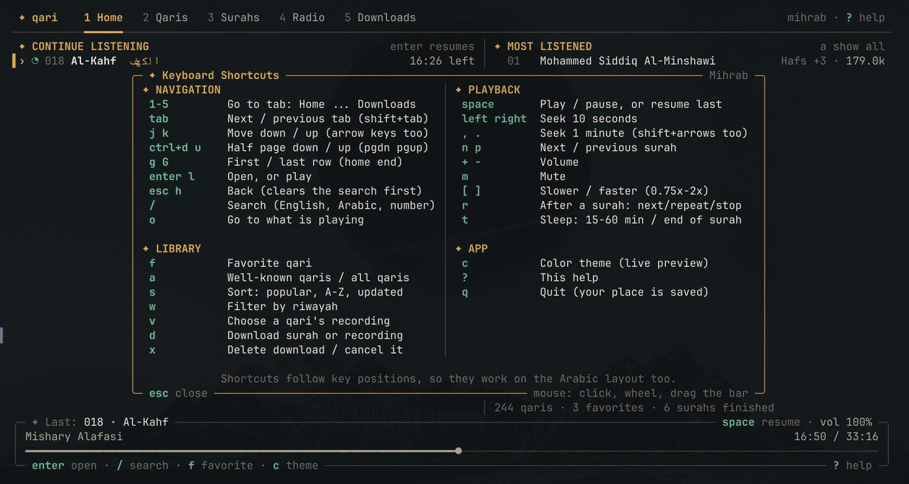

<div align="center">


<p>
<a href="https://github.com/3mro777o/qari/releases/latest"></a>
<a href="https://github.com/3mro777o/qari/actions/workflows/ci.yml"></a>
<a href="https://github.com/3mro777o/qari/actions/workflows/install.yml"></a>

<a href="LICENSE"></a>
</p>

[English](README.md) · [العربية](README.ar.md) · [Türkçe](README.tr.md) · **Bahasa Indonesia** · [اردو](README.ur.md) · [Français](README.fr.md) · [Deutsch](README.de.md)

</div>

**qari** adalah pemutar Al-Qur'an yang hidup di terminal Anda. Aplikasi ini menampilkan lebih dari
240 qari dan seluruh 114 surah dari [mp3quran.net](https://mp3quran.net), memutarnya lewat
[mpv](https://mpv.io), mengingat posisi terakhir Anda di setiap surah, mengulang ayat untuk
hafalan, dan menyimpan surah di disk agar bisa didengarkan tanpa internet. Tanpa akun, tanpa iklan,
tanpa pelacakan.

<div align="center">

</div>

## Daftar isi

- [Sorotan](#sorotan)
- [Instalasi](#instalasi) · [Pembaruan](#pembaruan) · [Menghapus instalasi](#menghapus-instalasi)
- [Lima menit pertama](#lima-menit-pertama)
- [Panduan](#panduan): [Menghafal dengan pengulangan ayat](#menghafal-dengan-pengulangan-ayat) ·
  [Putar acak dan resep](#putar-acak-dan-resep) · [Mendengarkan offline](#mendengarkan-offline) ·
  [Perintah dan pelengkapan Tab](#perintah-dan-pelengkapan-tab) · [Radio, riwayat dengar, dan favorit](#radio-riwayat-dengar-dan-favorit) ·
  [Tema](#tema) · [Tombol media](#tombol-media) · [Teks Arab](#teks-arab) · [Jaringan yang diblokir](#jaringan-yang-diblokir)
- [Semua tombol](#semua-tombol) · [Opsi](#opsi)
- [Pemecahan masalah](#pemecahan-masalah)
- [Lokasi data](#lokasi-data) · [Privasi](#privasi) · [Data popularitas](#data-popularitas)
- [Membangun dari sumber](#membangun-dari-sumber) · [Kredit](#kredit) · [Lisensi](#lisensi)

## Sorotan

| | |
| --- | --- |
| 🎙️ **240+ qari, 114 surah** | Jelajahi per qari atau per surah. Qari terkenal dengan rekaman lengkap tampil paling atas, diurutkan berdasarkan jumlah pendengar sungguhan. |
| 🔎 **Cari dengan aksara apa pun** | `alafasi`, `العفاسي`, dan `العَفاسي` menemukan qari yang sama; `kahf`, `18`, dan `الكهف` menemukan surah yang sama. |
| 📖 **Hafalan** | Ulangi rentang ayat: setiap ayat N kali, seluruh rentang M kali, dengan jeda di antaranya. |
| ⏯️ **Ingat posisi Anda** | Setiap surah menyimpan posisinya. *Continue listening* (Lanjutkan mendengarkan) melanjutkannya; surah yang selesai diberi ✓. |
| 🎲 **Putar acak** | Resep seperti *Short surahs* (Surah pendek) atau *Daily surahs* (Surah harian: Al-Kahfi, Yasin, Al-Mulk…), atau resep buatan Anda sendiri. |
| 💾 **Offline** | Unduh satu surah atau satu rekaman utuh; setelah itu diputar dari disk tanpa jaringan. |
| ⌨️ **Perintah dengan Tab** | `qari play alafasi kahf` dari shell. Tab melengkapi nama qari, surah, dan stasiun. |
| 📻 **Radio langsung** | Stasiun radio Al-Qur'an dari mp3quran.net. |
| 🎨 **Lima tema** | Terinspirasi seni Islam: Mihrab, Al-Andalus, Samarkand Lapis, Madinah, High Contrast. |
| 🖱️ **Keyboard dan mouse** | Tombol ala vim/mpv yang juga berfungsi di tata letak keyboard Arab, plus klik, gulir, dan geser untuk melompat. |

## Instalasi

Satu perintah memasang qari **dan** mpv (mesin audio yang dipakai qari). Salin ke terminal lalu
tekan Enter.

**Linux dan macOS**

```sh
curl -fsSL https://3mro777o.github.io/qari/install.sh | sh
```

**Windows** (buka *PowerShell* dari menu Start; tidak perlu admin)

```powershell
irm https://3mro777o.github.io/qari/install.ps1 | iex
```

Lalu ketik `qari` dan tekan Enter. Jika perintah tidak ditemukan, buka jendela terminal baru.

<details>
<summary><b>Apa sebenarnya yang dilakukan perintah instalasi?</b></summary>

Anda sebaiknya tahu apa yang dilakukan sebuah perintah sebelum menyalurkannya ke shell. Kedua skrip
ini pendek; baca di sini: [install.sh](install.sh), [install.ps1](install.ps1).

**Linux** ([install.sh](install.sh))
1. Memasang mpv dengan pengelola paket Anda (`pacman`, `apt`, `dnf`, atau `zypper`) jika belum ada.
   Langkah ini meminta kata sandi Anda. Jika gagal, qari tetap terpasang dan meminta Anda memasang mpv sendiri.
2. Mengunduh rilis qari terbaru untuk CPU Anda (x86-64 atau ARM64) dari GitHub Releases.
3. Memeriksa unduhan terhadap `checksums.txt` milik rilis tersebut (SHA-256) dan berhenti jika tidak cocok.
4. Menaruh program `qari` di `/usr/local/bin` (meminta kata sandi Anda), yang ada di PATH di mana saja.
5. Menyiapkan pelengkapan Tab untuk shell yang Anda miliki: bash, zsh, dan fish.

**macOS** ([install.sh](install.sh)): memakai [Homebrew](https://brew.sh) (pasang dulu). Skrip
menambahkan repositori ini sebagai tap, lalu menjalankan `brew install qari`, yang sekaligus memasang
mpv dan pelengkapan Tab. Setelah itu Homebrew menjaga keduanya tetap terbaru lewat `brew upgrade`.

**Windows** ([install.ps1](install.ps1))
1. Mengunduh rilis qari terbaru dari GitHub Releases dan memeriksa checksum SHA-256-nya.
2. Menaruh `qari.exe` di `%LOCALAPPDATA%\Programs\qari` (folder pengguna Anda, jadi tanpa hak admin).
3. Jika mpv belum ada, mengunduh build mpv portabel dari
   [shinchiro](https://github.com/shinchiro/mpv-winbuild-cmake) ke `%LOCALAPPDATA%\Programs\mpv`.
4. Menambahkan kedua folder ke PATH pengguna Anda, sehingga `qari` berfungsi di terminal baru mana pun.
5. Menambahkan satu baris ke profil PowerShell Anda untuk mengaktifkan pelengkapan Tab.

</details>

> [!NOTE]
> **Smart App Control di Windows** memblokir program yang tidak ditandatangani kode (code-signed),
> dan qari belum ditandatangani. Jika Windows menolak menjalankan `qari.exe`, itulah sebabnya.
> Lihat [Pemecahan masalah](#pemecahan-masalah).

<details>
<summary><b>Cara instalasi lain</b> (Homebrew, Scoop, biner, Go)</summary>

**Homebrew** (macOS dan Linux):

```sh
brew tap 3mro777o/qari https://github.com/3mro777o/qari
brew trust 3mro777o/qari   # versi Homebrew yang lebih baru meminta ini
brew install qari
```

**Scoop** (Windows):

```powershell
scoop bucket add qari https://github.com/3mro777o/qari
scoop bucket add extras
scoop install qari mpv
```

**Biner siap pakai:** unduh arsip untuk sistem Anda dari
[Releases](https://github.com/3mro777o/qari/releases), ekstrak, lalu taruh `qari` di salah satu folder
dalam `PATH` Anda. Pasang **mpv** sendiri (`sudo apt install mpv`, `brew install mpv`, …).

**Dengan Go 1.24+** (juga butuh mpv):

```sh
go install github.com/3mro777o/qari@latest
```

</details>

**Terminal:** terminal modern apa pun bisa. Di Windows gunakan *Windows Terminal* (bawaan di
Windows 11). Untuk nama berbahasa Arab, lihat [Teks Arab](#teks-arab).

### Pembaruan

Jalankan lagi perintah instalasi. Perintah itu selalu mengambil rilis terbaru dan mengganti yang
lama; favorit, progres, dan unduhan Anda tetap ada. Pengguna Homebrew juga bisa menjalankan
`brew upgrade qari`.

qari memeriksa GitHub sekali sehari dan menampilkan *"qari X is out"* (qari X sudah rilis) di
footer-nya saat versi baru tersedia.

### Menghapus instalasi

Data Anda terpisah dari programnya; hapus juga jika Anda ingin penghapusan yang bersih
(lihat [Lokasi data](#lokasi-data)).

<details>
<summary><b>Linux, macOS, Windows</b></summary>

**Linux**

```sh
sudo rm /usr/local/bin/qari
rm -f ~/.local/share/bash-completion/completions/qari ~/.config/fish/completions/qari.fish
sudo rm -f /usr/local/share/zsh/site-functions/_qari
rm -rf ~/.local/state/qari ~/.cache/qari ~/.local/share/qari   # data Anda, opsional
```

Jika pelengkapan zsh ditambahkan ke `~/.zshrc`, hapus baris yang diakhiri `# qari Tab completion`.

**macOS**

```sh
brew uninstall qari && brew untap 3mro777o/qari
rm -rf ~/.local/state/qari ~/Library/Caches/qari ~/.local/share/qari   # data Anda, opsional
```

**Windows** (PowerShell)

```powershell
Remove-Item -Recurse "$env:LOCALAPPDATA\Programs\qari"
Remove-Item -Recurse "$env:LOCALAPPDATA\Programs\mpv"            # hanya jika dipasang oleh installer
Remove-Item -Recurse "$env:APPDATA\qari", "$env:LOCALAPPDATA\qari" # data Anda, opsional
```

Lalu hapus kedua folder itu dari PATH pengguna Anda (*Settings → System → About → Advanced system
settings → Environment Variables*) dan baris `qari completion` dari profil Anda (`notepad $PROFILE`).

</details>

## Lima menit pertama

1. **Buka.** Ketik `qari`. Anda akan masuk ke **Home** (Beranda): *Continue listening*, qari favorit
   Anda, dan qari yang paling banyak didengarkan. Tab di bagian atas adalah `1` Home, `2` Qaris,
   `3` Surahs, `4` Radio, `5` Downloads (Unduhan), `6` History (Riwayat dengar), `7` Settings. Tekan angka atau
   `tab` untuk berpindah.

   

2. **Cari qari.** Tekan `2`, lalu `/` dan ketik sebagian nama, misalnya `alafasi` atau `العفاسي`.
   Bergerak dengan `j`/`k` atau tombol panah, buka dengan `enter`.
3. **Putar surah.** Halaman qari menampilkan surah-surahnya. Pilih satu dan tekan `enter`. Pemutar
   di bagian bawah menampilkan surah, waktu, dan bilah progres. `space` menjeda, `←`/`→` melompat
   10 detik, `n`/`p` pindah ke surah berikutnya atau sebelumnya.

   

4. **Sesuaikan.** `f` menandai qari favorit, `[`/`]` mengubah kecepatan, `t` memasang pengatur waktu
   tidur, `c` mengganti warna.
5. **Keluar dengan `q`.** Posisi Anda tersimpan. Lain kali, *Continue listening* atau `space`
   melanjutkannya.

Bingung? Tekan `?` untuk melihat semua tombol di layar yang sedang Anda buka.

## Panduan

### Menghafal dengan pengulangan ayat

Mengulang beberapa ayat berkali-kali adalah cara klasik untuk menghafal. qari tahu di mana setiap
ayat mulai dan berakhir untuk sekitar 115 rekaman, jadi ia bisa mengulang tepat ayat-ayat yang Anda
inginkan.

1. Putar sebuah surah (misalnya Al-Kahfi oleh Mishary Alafasy).
2. Tekan `e`. Sebuah jendela terbuka:

   | Kolom | Arti |
   | --- | --- |
   | **From ayah / To ayah** | Rentang yang diulang (dari ayat / sampai ayat). |
   | **Each ayah** | Berapa kali setiap ayat diputar sebelum lanjut (1–99). |
   | **Whole range** | Berapa kali seluruh rentang diputar (`0` = sampai Anda menghentikannya). |
   | **Gap** | Detik hening sebelum setiap pengulangan, waktu untuk Anda melafalkannya sendiri. |

   Pindah antarkolom dengan `j`/`k`, ubah nilai dengan `←`/`→` atau ketik angkanya, lalu tekan
   `enter` untuk memulai.

   

3. Pemutar menunjukkan posisi Anda, misalnya `ayah 3/10 · 2 of 3`. Tekan `esc` untuk berhenti.

**Ulang cepat sambil mendengarkan:** tekan `i` saat ayat pertama yang Anda inginkan dimulai, dan
`i` lagi saat ayat terakhir dibacakan. qari akan mengulang rentang itu. `i` ketiga menghentikannya.
`u` mengubah berapa kali setiap ayat diputar (1, 2, 3, 5, 7, 10).

Pengaturan Anda diingat, dan pengulangan juga berfungsi pada surah yang sudah diunduh tanpa
jaringan. Jika sebuah rekaman tidak punya data waktu ayat, qari memberi tahu Anda dan menunjukkan
rekaman lain dari qari yang sama yang memilikinya (ganti dengan `v`).

### Putar acak dan resep

Tekan `z` untuk memilih **resep**: deskripsi tersimpan tentang apa yang diputar secara acak. Saat
satu surah selesai, surah acak lain dimulai; tidak ada surah dari qari yang sama yang terulang
sampai resepnya habis. `n` memilih yang lain, `p` kembali.

Resep bawaan:

| Resep | Yang diputar |
| --- | --- |
| *Anything* (Apa saja) | Qari terkenal, riwayat Hafs, Murattal |
| *Favorite qaris* (Qari favorit) | Hanya qari favorit Anda |
| *Short surahs* (Surah pendek) | Juz Amma |
| *Daily surahs* (Surah harian) | Al-Kahfi, As-Sajdah, Yasin, Al-Waqi'ah, Al-Mulk |
| *Mujawwad* | Bacaan Mujawwad |
| *Random radio* / *Favorite radios* | Stasiun radio langsung |

Buat resep sendiri dengan `a`, atau salin resep bawaan dengan `c` lalu ubah. Resep menyaring
berdasarkan qari (semua, yang terkenal, favorit, atau daftar pilihan Anda), riwayat, gaya bacaan
(Murattal, Mujawwad, …), dan surah (semua, Juz Amma, atau daftar Anda). Di editor, `enter` mengubah
kolom, `/` mencari di daftar, dan `s` menyimpan.

### Mendengarkan offline

Tekan `d` pada sebuah surah untuk mengunduhnya, atau pada sebuah rekaman untuk mengunduh semuanya
(tekan `d` dua kali untuk konfirmasi). Tab **Downloads** (`5`) menampilkan antrean beserta progres
dan kecepatannya. Surah yang sudah diunduh diputar dari disk, jadi tetap jalan di pesawat dan
menghemat kuota. `x` menghapus atau membatalkan unduhan.


### Perintah dan pelengkapan Tab

Anda bisa langsung memutar dari shell. Nama boleh sebagian, dalam bahasa Inggris atau Arab; surah
bisa berupa nomor atau nama. Jika sebuah nama cocok dengan beberapa qari, qari menampilkan daftarnya.

```sh
qari play alafasi 18              # Al-Kahfi oleh Mishary Alafasy, dari posisi terakhir Anda
qari play alafasi                 # lanjutkan yang terakhir Anda dengar dari qari itu
qari radio ajmy                   # stasiun radio langsung
qari random "short surahs"        # putar acak dari sebuah resep (tanpa nama: yang terakhir dipakai)
qari play alafasi yasin --no-ui   # tanpa antarmuka: satu baris status, ctrl+c untuk berhenti
qari help                         # semua perintah
```

Antarmuka terbuka dalam keadaan sudah memutar, dengan semua tombol tersedia. Dengan `--no-ui`, qari
memutar di latar belakang terminal Anda dan mencetak satu baris status; surah berikutnya menyusul
seperti di aplikasi, dan posisi Anda tersimpan dengan cara yang sama.

**Pelengkapan Tab** disiapkan oleh perintah instalasi untuk bash, zsh, fish, dan PowerShell. Ketik
`qari play al` lalu tekan Tab: Anda mendapat nama qari yang cocok; setelah sebuah nama, Tab
menawarkan surah-surah qari tersebut. Ia juga melengkapi perintah, opsi, stasiun radio, resep, dan
tema.


Untuk memasangnya secara manual, muat keluaran `qari completion bash|zsh|fish|powershell` di file
startup shell Anda. Pelengkapan mempelajari nama-nama setelah Anda membuka qari sekali.

### Radio, riwayat dengar, dan favorit

- **Radio** (`4`): stasiun radio Al-Qur'an langsung dari mp3quran.net. `f` menandai stasiun favorit.
- **History** (`6`): 200 surah dan stasiun terakhir yang Anda putar, dikelompokkan per hari, beserta
  posisi terakhir Anda. `enter` memutarnya lagi dari titik itu; `x` menghapus satu entri.
- **Settings** (`7`, Pengaturan): buffer (seberapa banyak surah yang disimpan mpv di memori, bawaan
  25 MB), volume dan kecepatan (diingat), bahasa nama, nama Arab, notifikasi, tema, riwayat, urutan
  dan pengulangan. `enter` atau `→` mengubah satu baris, `←` mundur. Opsi seperti `--lang` diutamakan.
- **Favorit:** `f` pada qari menambahkannya ke Home dan ke resep *Favorite qaris*.
- **Tampilkan semua:** secara bawaan Anda melihat qari terkenal dengan rekaman lengkap. `a`
  menampilkan semuanya, termasuk rekaman parsial dan yang kurang dikenal. `s` mengurutkan
  berdasarkan popularitas, nama, atau yang terakhir diperbarui, `w` menyaring berdasarkan riwayat
  (Hafs, Warsy, Qalun, …), `v` memilih salah satu rekaman qari.

### Tema

Tekan `c`: seluruh layar menampilkan pratinjau setiap tema saat Anda bergerak, `enter` memakainya,
`esc` kembali. Tidak ada tema yang mewarnai latar belakang, jadi terminal transparan tetap transparan.

| Tema | Tampilan |
| --- | --- |
| `mihrab` | **Mihrab** (bawaan): emas sepuhan yang hangat, pualam, dan hijau sage |
| `andalus` | **Al-Andalus**: terakota Alhambra, pirus berglasir, dan gading |
| `lapis` | **Samarkand Lapis**: biru lapis lazuli Timuriyah, daun emas, dan sutra bermandi cahaya bulan |
| `madinah` | **Madinah**: zamrud bercahaya, kuningan lembut, dan mutiara hangat |
| `contrast` | **High Contrast**: putih, emas cerah, dan sian elektrik |


### Tombol media

Di Linux, qari mendaftar sebagai pemutar MPRIS (`org.mpris.MediaPlayer2.qari`), sehingga tombol media
keyboard, widget desktop, dan `playerctl -p qari play-pause` bisa mengendalikannya, dan sebuah
notifikasi muncul untuk setiap surah baru. Di macOS dan Windows belum ada dukungan tombol media;
notifikasinya tetap muncul.

### Teks Arab

Nama ditampilkan dalam bahasa Inggris secara bawaan, dan Anda selalu bisa mencari dalam bahasa Arab:
`البقره` menemukan Al-Baqarah. `--lang` mengganti nama qari dan surah ke salah satu dari 21 bahasa
yang disediakan API (`--lang ar`, `--lang fr`, `--lang ur`, …; `--languages` menampilkan daftarnya).
`--arabic` menambahkan nama surah berbahasa Arab di samping nama bahasa Inggrisnya.

Bahasa Arab membutuhkan terminal yang mendukung teks kanan-ke-kiri: Konsole, GNOME Terminal dan
terminal VTE lainnya, WezTerm, mlterm, Windows Terminal. Di terminal lain, huruf Arab bisa tampil
terbalik atau tidak tersambung.

Pintasan mengikuti posisi tombol, jadi juga berfungsi di tata letak keyboard Arab: `ض` keluar seperti
`q`, `ظ` mencari seperti `/`.

### Jaringan yang diblokir

Beberapa jaringan sekolah dan kantor memblokir mp3quran.net. Jika daftar tidak termuat, gunakan proxy
yang boleh Anda pakai:

```sh
qari --proxy socks5://127.0.0.1:1080
```

mpv tidak bisa memakai proxy SOCKS, jadi qari meneruskan audio ke mpv melalui relay lokal kecil;
melompat tetap berfungsi, dan unduhan memakai proxy yang sama.

## Semua tombol

Tekan `?` di aplikasi untuk melihat daftar ini. Tombol-tombolnya mengikuti mpv, cmus, dan vim.

| Tombol | Fungsi |
| --- | --- |
| `1`–`7`, `tab` / `shift+tab` | Home, Qaris, Surahs, Radio, Downloads, History, Settings |
| `j` `k` / `↓` `↑` | Bergerak |
| `ctrl+d` `ctrl+u` / `pgdn` `pgup` | Setengah halaman ke bawah / atas |
| `g` `G` / `home` `end` | Baris pertama / terakhir |
| `enter` / `l` | Buka, atau putar |
| `esc` / `h` | Kembali (menghapus pencarian dulu) |
| `/` | Cari di daftar saat ini (Inggris, Arab, atau nomor surah) |
| `o` | Ke yang sedang diputar |
| `space` | Putar / jeda (melanjutkan surah terakhir Anda saat diam) |
| `←` `→` | Lompat 10 detik |
| `,` `.` (atau `shift+←` `shift+→`) | Lompat 1 menit |
| `n` `p` | Surah berikutnya / sebelumnya (di putar acak: pilihan lain / kembali) |
| `z` | Acak: `enter` memutar resep; `a` baru, `e` edit, `c` salin, `x` hapus (tekan dua kali) |
| `+` `-` | Volume |
| `m` | Bisukan |
| `[` `]` | Lebih lambat / lebih cepat (0.75×–2×, nada suara tetap) |
| `r` | Setelah surah selesai: putar berikutnya otomatis, ulangi, atau berhenti |
| `t` | Pengatur waktu tidur (15–60 menit atau akhir surah) |
| `e` | Ulangi ayat untuk menghafal |
| `i` | Ulang cepat: ayat pertama, ayat terakhir, berhenti |
| `u` | Berapa kali setiap ayat yang diulang diputar (1–10) |
| `f` | Qari atau stasiun favorit |
| `a` | Qari terkenal / semua qari |
| `s` | Urutkan qari: populer, A–Z, terakhir diperbarui |
| `w` | Saring berdasarkan riwayat |
| `v` | Pilih rekaman qari |
| `d` | Unduh surah atau seluruh rekaman (minta ditekan lagi) |
| `x` | Hapus atau batalkan unduhan; hapus entri History |
| `c` | Tema warna |
| `?` | Bantuan |
| `q` / `ctrl+c` | Keluar (posisi Anda tersimpan) |

**Mouse:** klik tab dan baris, klik baris sekali lagi untuk membuka atau memutarnya, gulir dengan
roda mouse, klik atau geser bilah progres untuk melompat.



## Opsi

```text
qari [options]
qari play <qari> [surah] [--no-ui]
qari radio <station> [--no-ui]
qari random [recipe] [--no-ui]
qari completion bash|zsh|fish|powershell

--lang CODE    language for qari and surah names (default eng; see --languages)
--languages    list the languages the API offers
--theme NAME   color theme (see --themes; overrides the saved choice)
--themes       list the themes
--proxy URL    send all traffic through a proxy, e.g. socks5://127.0.0.1:1080
--arabic       also show the Arabic surah names
--no-notify    no desktop notification when a surah starts
--no-ui        with play, radio or random: play without the interface
--version      print the version
```

`QARI_LANG`, `QARI_THEME`, dan `QARI_PROXY` mengatur nilai bawaan yang sama dari environment.

## Pemecahan masalah

<details>
<summary><b>Windows: "An Application Control policy has blocked this file" / Smart App Control</b></summary>

Smart App Control memblokir setiap program yang tidak ditandatangani kode, dan qari belum
ditandatangani (permohonan code signing gratis untuk proyek open-source sudah diajukan). Sampai saat
itu, satu-satunya cara adalah mematikan Smart App Control di *Windows Security → App & browser
control → Smart App Control settings*. Sebagian besar PC sudah mematikannya; fitur ini hanya aktif
pada sebagian instalasi baru Windows 11.

</details>

<details>
<summary><b>"qari: command not found" tepat setelah instalasi</b></summary>

Buka terminal baru: terminal lama belum melihat PATH yang diperbarui. Di Linux, pastikan
`/usr/local/bin` ada di PATH Anda (`echo $PATH`).

</details>

<details>
<summary><b>"Install mpv to play audio" / tidak ada suara</b></summary>

qari memutar lewat mpv. Pasang dengan pengelola paket Anda (`sudo apt install mpv`,
`sudo pacman -S mpv`, `brew install mpv`), atau jalankan lagi perintah instalasi. Pastikan
`mpv --version` berjalan di terminal baru.

</details>

<details>
<summary><b>Daftar tidak termuat</b></summary>

mp3quran.net kemungkinan diblokir di jaringan Anda; lihat [Jaringan yang diblokir](#jaringan-yang-diblokir).
qari menyimpan daftar yang terakhir dimuat untuk dipakai offline, dan surah yang sudah diunduh selalu
bisa diputar.

</details>

<details>
<summary><b>Teks Arab tampil terbalik atau tidak tersambung</b></summary>

Terminal Anda tidak mendukung teks kanan-ke-kiri. Gunakan salah satu terminal yang tercantum di
[Teks Arab](#teks-arab), atau jalankan tanpa `--arabic` dan `--lang ar`.

</details>

<details>
<summary><b>Tab tidak menampilkan apa-apa</b></summary>

Buka qari sekali agar ia menyimpan daftarnya; pelengkapan membaca nama dari sana. Di bash, paket
`bash-completion` harus terpasang. Buka terminal baru setelah instalasi.

</details>

<details>
<summary><b>macOS: "Refusing to load formula from untrusted tap"</b></summary>

Jalankan `brew trust 3mro777o/qari`, lalu pasang lagi. Perintah instalasi sudah melakukan ini untuk Anda.

</details>

Masalah lain? [Buka issue](https://github.com/3mro777o/qari/issues) dengan menyebutkan sistem Anda dan
apa yang Anda lihat.

## Lokasi data

| Apa | Linux / macOS | Windows |
| --- | --- | --- |
| Favorit, progres, resep, riwayat dengar, pengaturan | `~/.local/state/qari/state.json` | `%AppData%\qari\state.json` |
| Cache katalog | `~/.cache/qari/` (`~/Library/Caches/qari/` di macOS) | `%LocalAppData%\qari\` |
| Surah yang diunduh | `~/.local/share/qari/` | `%LocalAppData%\qari\` |

Di Linux, variabel `XDG_STATE_HOME`, `XDG_CACHE_HOME`, dan `XDG_DATA_HOME` memindahkan folder-folder ini.

## Privasi

qari tidak memakai akun dan tidak mengirim analitik. Ia hanya terhubung ke dua tempat: mp3quran.net
(daftar, audio, dan data waktu ayat) dan GitHub (sekali sehari, untuk memeriksa apakah ada rilis yang
lebih baru). Semua yang diingatnya tetap tersimpan di komputer Anda.

## Data popularitas

mp3quran.net tidak menerbitkan jumlah putar. Popularitas berasal dari snapshot di
[`internal/popular/popular.json`](internal/popular/popular.json), yang dibuat oleh
[`tools/genpopular`](tools/genpopular/main.go) dari:

- **jumlah pendengar** yang diterbitkan [way2quran.com](https://www.way2quran.com/en/reciters?sortBy=-totalListens)
- **"terkenal"**: qari tersebut juga ada di [quranicaudio.com](https://quranicaudio.com) atau
  [quran.com](https://quran.com), atau way2quran menandainya sebagai qari teratas

Qari dicocokkan antarsitus berdasarkan nama Arab dan Inggrisnya. Perbarui snapshot dengan
`go run ./tools/genpopular`.

## Membangun dari sumber

Butuh Go 1.24+ dan mpv.

```sh
git clone https://github.com/3mro777o/qari && cd qari
go build -o qari . && ./qari
go test ./...
```

Kodenya: `internal/api` (klien dan cache mp3quran.net), `internal/player` (mpv lewat JSON IPC),
`internal/store` (status tersimpan), `internal/ui` (antarmuka [Bubble Tea](https://github.com/charmbracelet/bubbletea)).
Rilis dibangun oleh [GoReleaser](https://goreleaser.com) saat tag `v*` di-push.

## Kredit

Bacaan, nama, radio, dan data waktu ayat: [mp3quran.net](https://mp3quran.net). Data popularitas:
way2quran.com, quranicaudio.com, dan quran.com. Dibangun dengan
[Bubble Tea](https://github.com/charmbracelet/bubbletea) dan [mpv](https://mpv.io).

## Lisensi

[MIT](LICENSE). Terjemahan bisa tertinggal dari versi bahasa Inggris; jika ada perbedaan, README
bahasa Inggris yang menjadi acuan.
